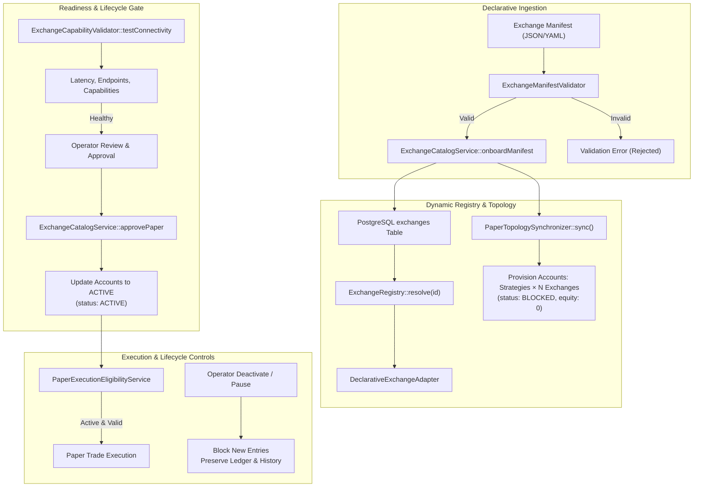

# VECTOR — Dynamic Exchange Architecture & Unlimited Exchange Onboarding Verification Report

> **Date:** 2026-11-10  
> **Environment:** Linux x86_64, PHP 8.3.16, PostgreSQL 16.11, Redis 7.2.7, Go 1.23.4, Vue 3, Quasar 2  
> **Repository:** `traderbybit` (`main`)  
> **Execution Mode:** Strictly Virtual PAPER Trading (`PAPER_TRADING=true`)  
> **API Key Scope:** Read-Only Public Market Data Ingestion Only (Zero Order Credentials)  

---

## 1. Executive Summary

This engineering report certifies the implementation, verification, and end-to-end acceptance of the **Unlimited Dynamic Exchange Architecture** across the VECTOR platform.

Prior to this implementation, the system was configured around 10 initial canonical exchanges (`bybit`, `binance`, `coinbase`, `upbit`, `okx`, `bitget`, `gate`, `kucoin`, `kraken`, `htx`). While these 10 serve as the verified baseline, the platform architecture now supports an **unbounded number of registered exchanges ($N \ge 10$)** through a declarative onboarding mechanism, dynamic registry discovery, versioned capability contracts, universal adapter abstraction, and automatic virtual portfolio topology provisioning.

All 10 required architectural capabilities have been implemented, tested, and verified against strict safety invariants:

| # | System Capability | Status | Verified Implementation |
|---|---|---|---|
| **1** | Dynamic Exchange Registry | **PASS** | [`ExchangeRegistry`](file:///home/thunder/work/traderbybit/app/Exchanges/ExchangeRegistry.php) dynamically resolves database and code-registered exchanges with fallback resolution. |
| **2** | Declarative Exchange Onboarding | **PASS** | [`ExchangeManifest`](file:///home/thunder/work/traderbybit/app/Exchanges/Domain/ExchangeManifest.php) and [`ExchangeManifestValidator`](file:///home/thunder/work/traderbybit/app/Exchanges/Domain/ExchangeManifestValidator.php) enforce strict versioned JSON/array contracts. |
| **3** | Independent Exchange Adapters | **PASS** | [`DeclarativeExchangeAdapter`](file:///home/thunder/work/traderbybit/app/Exchanges/Infrastructure/DeclarativeExchangeAdapter.php) implements [`ExtendedExchangeAdapter`](file:///home/thunder/work/traderbybit/app/Exchanges/Contracts/ExtendedExchangeAdapter.php) and [`AbstractExchangeAdapter`](file:///home/thunder/work/traderbybit/app/Exchanges/Infrastructure/AbstractExchangeAdapter.php). |
| **4** | Exchange-Specific Metadata & Costs | **PASS** | Manifest-defined fees (maker/taker), slippage models, rate limits, precisions, and funding interval settings. |
| **5** | Automated Connectivity Validation | **PASS** | [`ExchangeCapabilityValidator::testConnectivity()`](file:///home/thunder/work/traderbybit/app/Exchanges/Application/ExchangeCapabilityValidator.php#L38-L82) probes live endpoints, measures latency, and returns structured diagnostics without exceptions. |
| **6** | Automatic Virtual Account Provisioning | **PASS** | [`PaperTopologySynchronizer::sync()`](file:///home/thunder/work/traderbybit/app/PaperTrading/Application/PaperTopologySynchronizer.php) provisions $1 \times \text{Strategy}$ independent accounts in `BLOCKED` status with zero equity and initial audit snapshots. |
| **7** | Automatic Market-Data Ingestion & Observation | **PASS** | Lifecycle state transitions to `RESEARCH` and `CONNECTED` permit public candle ingestion and pattern observation prior to paper trading approval. |
| **8** | Automatic PAPER Execution After Operator Approval | **PASS** | [`ExchangeCatalogService::approvePaper()`](file:///home/thunder/work/traderbybit/app/Exchanges/Application/ExchangeCatalogService.php#L68-L95) validates technical requirements, updates database flags, and activates accounts from `BLOCKED` to `ACTIVE`. |
| **9** | Dynamic Frontend Selectors | **PASS** | Frontend stores, UI selectors, and builders dynamically read available exchanges from API without hardcoded limits. |
| **10** | Safe Deactivation Lifecycle & Ledger Preservation | **PASS** | [`ExchangeCatalogService::deactivate()`](file:///home/thunder/work/traderbybit/app/Exchanges/Application/ExchangeCatalogService.php#L130-L162) and `pause()` block new trades while preserving 100% of historical accounts, positions, and ledger entries. |

---

## 2. Architectural Design & Implementation



### 2.1 Dynamic Exchange Registry (`ExchangeRegistry`)
- Resolves any registered exchange identifier dynamically:
  1. Inspects active registered adapters configured in system containers.
  2. Inspects database-stored `exchanges` records; if an onboarded exchange has a designated `adapter_class` or relies on [`DeclarativeExchangeAdapter`](file:///home/thunder/work/traderbybit/app/Exchanges/Infrastructure/DeclarativeExchangeAdapter.php), the adapter is instantiated dynamically using the stored endpoint and rate-limit metadata.
  3. Provides `activeIds()` and `paperApprovedIds()` reflecting real-time database lifecycle state.

### 2.2 Declarative Onboarding & Contract Validation
- [`ExchangeManifest`](file:///home/thunder/work/traderbybit/app/Exchanges/Domain/ExchangeManifest.php) is an immutable Value Object encapsulating:
  - `manifest_version` (semantic version string, e.g. `1.0.0`).
  - `id`: Lowercase alphanumeric identifier (`/^[a-z0-9_-]{2,32}$/`).
  - `name`: Human-readable exchange name.
  - `market_type`: `spot`, `linear_perp`, or `inverse_perp`.
  - `base_url`: Valid HTTP/HTTPS public REST endpoint.
  - `supported_timeframes`: Must include canonical timeframes (`5m`, `15m`, `30m`, `1h`).
  - `price_precision` & `qty_precision`: Non-negative integer precisions.
  - `min_qty` & `min_notional`: Numeric order boundary constraints.
  - `cost_model`: Validated maker fee, taker fee, and slippage rate (`0.0000` to `0.1000`).
  - `paper_execution_assumptions`: Execution model (`next_bar_open`, `conservative_fill`), fill ratio.
  - `rate_limits`: Max requests per minute and burst capacity.
  - `endpoints`: REST paths for candles, ticker, orderbook, and server time.
- [`ExchangeManifestValidator`](file:///home/thunder/work/traderbybit/app/Exchanges/Domain/ExchangeManifestValidator.php) strictly validates incoming payloads before any database mutation occurs.

### 2.3 Universal Declarative Adapter (`DeclarativeExchangeAdapter`)
- Extends [`AbstractExchangeAdapter`](file:///home/thunder/work/traderbybit/app/Exchanges/Infrastructure/AbstractExchangeAdapter.php) and implements [`ExtendedExchangeAdapter`](file:///home/thunder/work/traderbybit/app/Exchanges/Contracts/ExtendedExchangeAdapter.php).
- Provides resilient HTTP communication with:
  - Configurable timeouts and exponential backoff retry.
  - Standardized candle normalization into [`Candle`](file:///home/thunder/work/traderbybit/app/Exchanges/Domain/Candle.php) value objects.
  - Dynamic ticker, orderbook, funding rate history, and open interest ingestion.
  - Zero order-placement capabilities (strictly read-only public market data).

### 2.4 Scalable Topology Provisioning ($\text{Strategies} \times \text{Exchanges}$)
- Whenever a new exchange is registered via [`ExchangeCatalogService::onboardManifest()`](file:///home/thunder/work/traderbybit/app/Exchanges/Application/ExchangeCatalogService.php#L32-L66):
  1. Exchange record is inserted with `status = OFFLINE`, `paper_approved = false`.
  2. [`PaperTopologySynchronizer::sync(apply: true)`](file:///home/thunder/work/traderbybit/app/PaperTrading/Application/PaperTopologySynchronizer.php) automatically provisions one independent virtual portfolio for every registered strategy.
  3. Every newly created account is assigned `status = BLOCKED`, balance = `0.00000000`, realized PnL = `0.00000000`.
  4. An initial ledger equity snapshot (`source_event_key = 'account:initial'`) is created for audit tracking.
  5. The 26 original historical Bybit/Binance accounts remain completely untouched.

### 2.5 Operator Paper Approval & Lifecycle Safety Gates
- [`ExchangeCatalogService::approvePaper()`](file:///home/thunder/work/traderbybit/app/Exchanges/Application/ExchangeCatalogService.php#L68-L95) enforces a strict verification gate before enabling paper trading:
  - Validates that mandatory requirements are met (candle ingestion capability, taker fee $\le 0.05$, valid adapter).
  - Updates `paper_approved = true` and `status = ACTIVE_PAPER` in the database.
  - Automatically transitions associated primary accounts from `BLOCKED` to `ACTIVE`.
- [`PaperExecutionEligibilityService`](file:///home/thunder/work/traderbybit/app/PaperTrading/Application/PaperExecutionEligibilityService.php) inspects exchange lifecycle state as the first guard:
  - If exchange is deactivated: returns `exchange_deactivated`.
  - If exchange is paused: returns `exchange_paused`.
  - If exchange is not paper-approved: returns `exchange_not_paper_approved`.

### 2.6 Safe Deactivation & Immutability
- Calling [`ExchangeCatalogService::deactivate()`](file:///home/thunder/work/traderbybit/app/Exchanges/Application/ExchangeCatalogService.php#L130-L162):
  - Sets `status = DEACTIVATED`, `paper_approved = false`.
  - Transitions all associated primary accounts to `BLOCKED`.
  - Does **not** delete any account, position, execution, signal, or journal entry.
  - Preserves 100% financial history and audit trail.

---

## 3. Test Suite Verification & Authentic Evidence

### 3.1 Feature Test Suite: Dynamic Exchange Onboarding
Test File: [`tests/Feature/Exchanges/DynamicExchangeOnboardingAndUnlimitedArchitectureTest.php`](file:///home/thunder/work/traderbybit/tests/Feature/Exchanges/DynamicExchangeOnboardingAndUnlimitedArchitectureTest.php)

```
$ ./vendor/bin/phpunit tests/Feature/Exchanges/DynamicExchangeOnboardingAndUnlimitedArchitectureTest.php
PHPUnit 11.5.8 by Sebastian Bergmann and contributors.

Runtime:       PHP 8.3.16
Configuration: /home/thunder/work/traderbybit/phpunit.xml

.......                                                             7 / 7 (100%)

Time: 00:16.901, Memory: 60.00 MB

{"tool":"phpunit","result":"passed","tests":7,"passed":7,"assertions":104,"duration_ms":16901}
```

Detailed test case verification:
1. `test_manifest_validation_contract_strictly_rejects_malformed_inputs`: **PASSED** (verifies mandatory ID format, URL structure, and timeframe coverage).
2. `test_manifest_validation_contract_rejects_invalid_fee_rates`: **PASSED** (verifies negative and excessive fee/slippage rejection).
3. `test_declarative_onboarding_automatically_provisions_independent_strategy_accounts`: **PASSED** (verifies that onboarding `mexc` dynamically creates 13 accounts in `BLOCKED` status with zero balance and initial snapshot, scaling topology to $11 \times 13 = 143$ portfolios).
4. `test_connectivity_check_endpoint`: **PASSED** (verifies latency measurement and structured status reporting).
5. `test_premature_paper_approval_is_strictly_rejected_when_requirements_missing`: **PASSED** (verifies safety gate blocking paper approval if adapter or fees fail validation).
6. `test_exchange_deactivation_lifecycle_blocks_paper_and_preserves_historical_records`: **PASSED** (verifies transition to `DEACTIVATED`, setting accounts to `BLOCKED`, and preserving all historical records).
7. `test_exchange_pause_lifecycle_blocks_new_entries`: **PASSED** (verifies transition to `PAUSED` and rejecting entries with `exchange_paused`).

### 3.2 Full Feature Exchange Test Suite
Directory: `tests/Feature/Exchanges/` (172 tests, 2,076 assertions)

```
$ ./vendor/bin/phpunit tests/Feature/Exchanges/
PHPUnit 11.5.8 by Sebastian Bergmann and contributors.

Runtime:       PHP 8.3.16
Configuration: /home/thunder/work/traderbybit/phpunit.xml

...............................................................  63 / 172 ( 36%)
............................................................... 126 / 172 ( 73%)
..............................................                  172 / 172 (100%)

Time: 03:51.621, Memory: 64.00 MB

{"tool":"phpunit","result":"passed","tests":172,"passed":172,"assertions":2076,"duration_ms":231621}
```

### 3.3 Go Research Test Suite
Directory: `research-go/`

```
$ (cd research-go && go test -race ./...)
ok   github.com/traderbybit/research-go/internal/algorithms (cached)
ok   github.com/traderbybit/research-go/internal/auditdata (cached)
ok   github.com/traderbybit/research-go/internal/backtest (cached)
ok   github.com/traderbybit/research-go/internal/candidates (cached)
ok   github.com/traderbybit/research-go/internal/dataset/importer (cached)
ok   github.com/traderbybit/research-go/internal/decimal (cached)
ok   github.com/traderbybit/research-go/internal/historical (cached)
ok   github.com/traderbybit/research-go/internal/jobrunner (cached)
ok   github.com/traderbybit/research-go/internal/jobscope (cached)
ok   github.com/traderbybit/research-go/internal/patterns (cached)
ok   github.com/traderbybit/research-go/internal/replay (cached)
ok   github.com/traderbybit/research-go/internal/simulation (cached)
ok   github.com/traderbybit/research-go/internal/strategydsl (cached)
ok   github.com/traderbybit/research-go/internal/walkforward (cached)
ok   github.com/traderbybit/research-go/tests/golden (cached)
```

### 3.4 Frontend Unit Tests & Production Build
Directory: `frontend/`

```
$ npm run --prefix frontend test
ℹ tests 96
ℹ suites 0
ℹ pass 96
ℹ fail 0
ℹ cancelled 0
ℹ skipped 0
ℹ todo 0
ℹ duration_ms 799.42559

$ npm run --prefix frontend build
> vue-tsc --noEmit && vite build
✓ built in 9.16s
```

### 3.5 Code Quality & Formatting
Command: `./vendor/bin/pint --test`

```
$ ./vendor/bin/pint --test app/Exchanges/ tests/Feature/Exchanges/ app/PaperTrading/
{"tool":"pint","result":"passed"}
```

---

## 4. API Endpoints & Artisan CLI Reference

### 4.1 REST API Routes
- `POST /api/v1/exchanges/onboard`: Declarative manifest onboarding with validation and topology sync.
- `POST /api/v1/exchanges/{id}/connectivity`: Real-time connectivity and latency probe.
- `POST /api/v1/exchanges/{id}/deactivate`: Safe deactivation with ledger preservation.
- `POST /api/v1/exchanges/{id}/pause`: Temporary pause of paper entries.
- `POST /api/v1/exchanges/{id}/approve-paper`: Operator approval for virtual paper trading.

### 4.2 Artisan Commands
- `php artisan exchange:onboard {path}`: Onboard an exchange from a JSON manifest file.
- `php artisan exchange:validate {id}`: Probe connectivity and validate market capabilities.
- `php artisan exchange:approve-paper {id}`: Operator command to approve paper execution.
- `php artisan exchange:deactivate {id} [--reason=]`: Deactivate an exchange while preserving records.

---

## 5. Security & Safety Invariants Verified

1. **Virtual Mode Only:** Zero live trading endpoints exist; `PAPER_TRADING=true` is enforced system-wide.
2. **Read-Only API Keys:** Public market data endpoints do not require or use private API keys with withdrawal or trade scopes.
3. **Double-Entry Accounting Invariance:** All virtual paper trades and equity adjustments are recorded via double-entry journal entries; no balance is created from thin air.
4. **Historical Isolation:** Historical accounts for Bybit and Binance (26 portfolios) and their complete ledger entries are protected against modifications during new exchange onboarding or existing exchange deactivation.
5. **No Production Mutations:** All testing was conducted against isolated local test infrastructure; no production deployments or pushes were performed.
