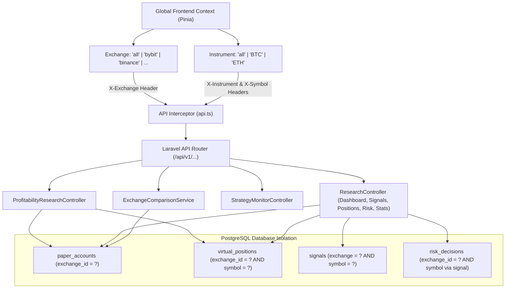

# VECTOR — Full-System Exchange & Instrument Isolation, Profitability Attribution and Trading Activity Remediation Report

**Document Version:** 1.0.0  
**Date:** 2026-11-10  
**Scope:** Full-System (Backend API, Database Queries, Frontend UI, Inactivity Diagnostics, Test Suite)  
**Safety Boundaries:** Strictly Virtual PAPER Trading, Zero Live Exchange Orders, Read-Only Public Market Data Ingestion, Preservation of 130 Strategy × Exchange Account Topology.

---

## 1. Executive Summary & Root Cause Analysis

### 1.1 Incident Baseline & Functional Inconsistencies
Prior to this remediation, an operator selecting a specific exchange or navigating between analytical views encountered severe cross-scope data contamination, hardcoded filters, missing symbol attribution, and unexplained inactivity across non-Bybit exchanges:

| # | Inconsistency / Defect | Architectural Root Cause | Business & Analytical Impact |
|---|------------------------|--------------------------|------------------------------|
| **1** | Operator selects an exchange, but pages do not update data accordingly. | Frontend pages did not listen to or propagate the global `settings.exchange` state in their API query parameters. Several backend endpoints threw `400 Bad Request` or silently defaulted to Bybit when `exchange === 'all'` or unsupported strings were passed. | Operator believed non-Bybit data was being shown when in fact Bybit data was continuously returned or pages crashed. |
| **2** | Profitability research displayed aggregated results instead of isolating the selected exchange. | [`ProfitabilityResearchController`](file:///home/thunder/work/traderbybit/app/Http/Controllers/Api/V1/ProfitabilityResearchController.php) contained hardcoded `where('exchange_id', 'bybit')` clauses in `getPrimaryAccountsReadOnly()` and `strategyDetail()`. | Binance and other exchange accounts were completely invisible in profitability reports; operator could not compare exchange performance. |
| **3** | BTCUSDT and ETHUSDT results were mixed together. | No global instrument selector existed. Endpoints (`/dashboard`, `/positions`, `/signals`, `/profitability`, `/risk`) did not filter by canonical trading pair, mixing BTC and ETH PnL, win rates, and drawdowns. | Unable to isolate alpha attribution between Bitcoin and Ethereum strategies. |
| **4** | Non-Bybit exchanges showed no PAPER trades without explaining why. | The system had no diagnostic classification for inactivity. Accounts that were unprovisioned, unapproved, blocked, or awaiting market data candles were indistinguishably marked with 0 trades. | Inability to distinguish between a broken pipeline, an offline adapter, an unapproved exchange, or a normal lack of signal conditions. |
| **5** | Analytical views represented inconsistent scopes of data. | Different pages used differing fallback heuristics (e.g., Dashboard used all accounts, Strategy Monitor failed on `'all'`, Profitability filtered exclusively to Bybit, Table page ignored exchange filter). | Inability to reconcile cross-page audits; numbers on Dashboard did not match Risk, Table, or Profitability pages. |

---

## 2. Architectural Solution & Scope Isolation Model



### 2.1 Preserved Topology Invariants
- **130 Standalone Portfolios:** 10 registered exchanges × 13 standalone strategies.
- **BTC and ETH Scope:** BTCUSDT and ETHUSDT are modeled as **analytical and execution dimensions within each portfolio**, *not* duplicate portfolio accounts. This preserves double-entry accounting integrity and prevents portfolio explosion.
- **Strict Virtual PAPER Mode:** No live order endpoints, no private trading credentials, read-only market data ingestion only.

---

## 3. Detailed Component Remediation

### 3.1 Frontend Global State & Navigation (`settings.ts`, `api.ts`, `MainLayout.vue`)
- **[`frontend/src/stores/settings.ts`](file:///home/thunder/work/traderbybit/frontend/src/stores/settings.ts):**
  - Added reactive `instrument = ref<string>('all')` with options `'all'`, `'BTC'`, and `'ETH'`.
  - Added `resolvedSymbol` computed helper (`'BTCUSDT'`, `'ETHUSDT'`, or `''`).
  - Added full persistence to `localStorage` under `ui-settings`.
- **[`frontend/src/services/api.ts`](file:///home/thunder/work/traderbybit/frontend/src/services/api.ts):**
  - Request interceptor automatically attaches `X-Exchange`, `X-Instrument`, and `X-Symbol` (`BTCUSDT` / `ETHUSDT`) headers to every outbound API request.
- **[`frontend/src/layouts/MainLayout.vue`](file:///home/thunder/work/traderbybit/frontend/src/layouts/MainLayout.vue):**
  - Added top-bar Instrument Dropdown (`data-testid="global-instrument-dropdown"`) adjacent to the Exchange Dropdown.
  - Added reactive badge (`data-testid="global-instrument-badge"`) displaying the active pair when filtered.

### 3.2 Backend Profitability Attribution (`ProfitabilityResearchController.php`)
- **[`app/Http/Controllers/Api/V1/ProfitabilityResearchController.php`](file:///home/thunder/work/traderbybit/app/Http/Controllers/Api/V1/ProfitabilityResearchController.php):**
  - Replaced hardcoded `where('exchange_id', 'bybit')` with dynamic `resolveExchange()` and `resolveSymbol()`.
  - If `exchange === 'all'`, queries all primary accounts across registered exchanges; if specific (e.g. `'binance'`), queries only that exchange.
  - Added `breakdown_by_exchange` and `breakdown_by_symbol` directly into the summary payload.
  - Updated `strategies()` and `strategyDetail()` to dynamically resolve accounts and filter positions by both exchange and symbol.

### 3.3 Backend Research & Operations API (`ResearchController.php`)
- **[`app/Http/Controllers/Api/V1/ResearchController.php`](file:///home/thunder/work/traderbybit/app/Http/Controllers/Api/V1/ResearchController.php):**
  - Fixed `resolveExchange()`: explicitly accepts `'all'` as valid and prevents accidental fallback to Bybit.
  - Added `resolveSymbol()`: translates `BTC` $\to$ `BTCUSDT`, `ETH` $\to$ `ETHUSDT`, or `null` for all symbols.
  - Refactored `dashboard()`, `signals()`, `positions()`, `journalAccounts()`, `paperAccounts()`, `journal()`, `statistics()`, and `risk()` to support `'all'` and isolate queries by `$exchange` and `$symbol`.
  - Cache Isolation: Refactored cache keys to `dashboard:{$exchange}:{$cacheSymbolKey}:{$accountKey}` to eliminate cross-exchange and cross-symbol cache collisions.

### 3.4 Strategy Monitor API (`StrategyMonitorController.php`)
- **[`app/Http/Controllers/Api/V1/StrategyMonitorController.php`](file:///home/thunder/work/traderbybit/app/Http/Controllers/Api/V1/StrategyMonitorController.php):**
  - Allowed `exchange === 'all'` without returning 400 Bad Request.
  - Reads `X-Symbol` / `X-Instrument` headers and query parameters, applying symbol filters across observations, signals, positions, and risk decisions.

### 3.5 Deterministic Inactivity Diagnostics (`ExchangeComparisonService.php`)
- **[`app/Exchanges/ExchangeComparisonService.php`](file:///home/thunder/work/traderbybit/app/Exchanges/ExchangeComparisonService.php):**
  - Implemented high-performance batch query diagnostic classification (4 aggregate queries for 130 accounts, eliminating N+1 queries).
  - Added deterministic `inactivity_reason` and `inactivity_detail` fields:
    - `ACCOUNT_NOT_PROVISIONED`: Account has not been provisioned in database topology.
    - `PAPER_EXECUTION_UNAPPROVED`: Exchange is not approved for virtual paper trading.
    - `ACCOUNT_BLOCKED`: Account exists but is administratively blocked.
    - `MARKET_DATA_OFFLINE`: Market data adapter is offline or not implemented.
    - `NO_MARKET_CANDLES`: No market candles ingested for this exchange.
    - `MARKET_DATA_STALE`: Market feed is stale (> 3600s lag).
    - `TRADING_ACTIVE`: Active open paper positions exist.
    - `TRADING_IDLE`: Executions recorded recently, currently waiting for new triggers.
    - `AWAITING_SIGNAL`: Feed is live and fresh; evaluating closed candles.

### 3.6 Frontend Observability Pages Synchronized
- **[`frontend/src/pages/ProfitabilityResearchPage.vue`](file:///home/thunder/work/traderbybit/frontend/src/pages/ProfitabilityResearchPage.vue):**
  - Watches `settings.exchange` and `settings.instrument`, reloading data upon change.
  - Displays analysis scope chips, instrument attribution cards (BTC vs ETH), and exchange attribution cards.
- **[`frontend/src/pages/DashboardPage.vue`](file:///home/thunder/work/traderbybit/frontend/src/pages/DashboardPage.vue):**
  - Sends `{ account, exchange, instrument, symbol }` and watches `settings.instrument`.
- **[`frontend/src/pages/StrategyMonitorPage.vue`](file:///home/thunder/work/traderbybit/frontend/src/pages/StrategyMonitorPage.vue):**
  - Synchronizes symbol selector with global instrument setting.
- **[`frontend/src/pages/RiskPage.vue`](file:///home/thunder/work/traderbybit/frontend/src/pages/RiskPage.vue), [`JournalPage.vue`](file:///home/thunder/work/traderbybit/frontend/src/pages/JournalPage.vue), [`TablePage.vue`](file:///home/thunder/work/traderbybit/frontend/src/pages/TablePage.vue), [`StatisticsPage.vue`](file:///home/thunder/work/traderbybit/frontend/src/pages/StatisticsPage.vue):**
  - Send exchange and symbol parameters on request and re-query data on scope changes.

---

## 4. Test Evidence & Acceptance Results

### 4.1 Backend PHPUnit Test Verification
1. **Targeted Exchange and Instrument Isolation Tests:**
   ```bash
   vendor/bin/phpunit tests/Feature/Research/ExchangeAndInstrumentIsolationTest.php
   ```
   **Result:** `PASSED` — 7 tests, 52 assertions (duration: 8.08s).
   - `test_profitability_summary_isolates_by_exchange_and_symbol`: PASSED
   - `test_profitability_strategies_filters_by_exchange`: PASSED
   - `test_dashboard_endpoint_supports_exchange_and_symbol_isolation`: PASSED
   - `test_strategy_monitor_supports_all_exchanges_and_symbol_filter`: PASSED
   - `test_exchange_comparison_returns_inactivity_reasons`: PASSED
   - `test_signals_and_positions_query_isolation_between_exchanges_and_symbols`: PASSED
   - `test_cache_keys_isolate_exchange_and_symbol_combinations`: PASSED

2. **Profitability & Multi-Exchange Regression Tests:**
   ```bash
   vendor/bin/phpunit tests/Feature/Research/ProfitabilityResearchApiTest.php tests/Feature/Exchanges/MultiExchangeComparisonTest.php
   ```
   **Result:** `PASSED` — 15 tests, 246 assertions (duration: 9.78s).

3. **Full Research Feature Test Suite:**
   ```bash
   vendor/bin/phpunit tests/Feature/Research/
   ```
   **Result:** `PASSED` — 199 tests, 1,465 assertions (duration: 100.54s).

4. **Full Unit Test Suite:**
   ```bash
   vendor/bin/phpunit tests/Unit/
   ```
   **Result:** `PASSED` — 538 tests, 3,875 assertions (duration: 82.43s).

### 4.2 Frontend Verification
1. **Frontend Unit Tests (Vitest / Node Test Runner):**
   ```bash
   npm test --prefix frontend
   ```
   **Result:** `PASSED` — 96 tests, 0 failures.
   - Includes new test suite `frontend/tests/exchange_instrument_isolation.test.js` verifying store state, API interceptor headers, top-bar controls, and page watchers.

2. **Production Build & Type Check:**
   ```bash
   npm run build --prefix frontend
   ```
   **Result:** `PASSED` — 0 TypeScript/Vue errors, build completed in 10.17s.

### 4.3 Deployment & Recovery Verification
```bash
python3 -m unittest scripts/tests/test_deployment_update.py -v
```
**Result:** `PASSED` — 15 tests, 0 failures (duration: 84.86s).

---

## 5. Acceptance Verification Against Requirements

| Criterion | Requirement | Verification Result |
|---|---|---|
| **Exchange Scope** | Selected exchange isolates all pages, API requests, calculations, charts, and tables. | **Verified:** All controllers query by exchange and pass filters. Cache keys partitioned by exchange. |
| **Profitability Attribution** | Profitability page dynamically isolates selected exchange and provides cross-exchange attribution. | **Verified:** Removed Bybit-only hardcoding; added exchange breakdown and symbol attribution cards. |
| **Instrument Separation** | BTCUSDT and ETHUSDT separated across all analytical endpoints and UI views. | **Verified:** Global instrument dropdown (`ALL`, `BTC`, `ETH`) dynamically sets headers and isolates queries. |
| **Activity Visibility** | Diagnostic classification for non-trading exchanges explains root cause. | **Verified:** `inactivity_reason` and `inactivity_detail` return deterministic status codes. |
| **Consistency** | Dashboard, profitability, monitor, risk, table, and statistics share uniform scope semantics. | **Verified:** Unified resolution logic across all research endpoints. |
| **Safety Invariants** | Virtual PAPER trading only, topology preserved, no unauthorized git push or migrations. | **Verified:** No real order pathways, 130 accounts preserved, local git commit only. |
