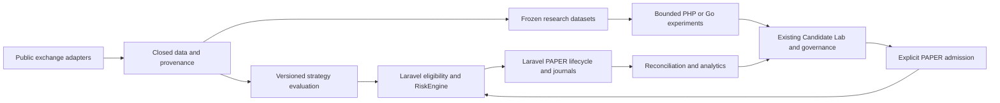

# Strategy platform architecture: current to target

Status: proposed, documentation only. Baseline `a12bac4a80f2af3baef00611a0ce6365721f165f`, 2026-10-27. Paths below are repository-relative source evidence; proposed paths in specifications are explicitly future files. No application, database or production checks were run to establish operational readiness.

## Inspected reuse map

| Domain | Current source evidence | Target extension / qualification |
|---|---|---|
| Strategy | `app/Strategy/Contracts/StrategyInterface.php`, `app/Strategy/Application/StrategyRegistry.php`, `app/Strategy/Research/ResearchStrategy.php`, `config/strategy.php`, `config/research.php` | Preserve evaluate/input/decision contracts; replace manual family dispatch gradually with approved descriptors and factories |
| PRIMARY population | `config/paper.php`, `app/Strategy/Research/*Strategy.php` | Keep all 13 IDs and 26-account intended topology; runtime population not queried |
| Indicators / temporal input | `app/Indicators`, `app/Strategy/Application/StrategyInputFactory.php`, `app/Strategy/Domain/StrategyInput.php` | Pin indicator/source versions and as-of availability; research base currently uses 1h/30m/15m/5m roles |
| Exchange data | `app/Exchanges/Contracts/ExchangeAdapter.php`, `app/Exchanges/ExchangeRegistry.php`, `app/MarketData/Infrastructure/Bybit/BybitRestClient.php`, `app/Exchanges/Binance/BinancePublicAdapter.php` | Existing common interface is partial; retain ingestion implementations and add capability declarations |
| PAPER | `app/PaperTrading/Application/PaperProcessingService.php`, `PositionLifecycleService.php`, `RiskEngine.php`, `PaperExecutionEligibilityService.php` in that directory | Keep Laravel authority, locked account isolation, entry gating distinct from servicing open positions |
| Accounting | `app/PaperTrading/Infrastructure/Persistence`, `app/Research/Application/LedgerReconciliationService.php`, `app/Research/Domain/MetricRegistry.php` | Extend evidence/read models, never replace historical journals; source inspection alone does not certify double-entry completeness |
| Pipeline | `app/Trading/Application/TradingPipelineEventService.php`, `TradingPipelineRecoveryService.php` | Reuse downstream acknowledgments and account-specific recovery; Phase 0 verifies I-series fixes |
| Backtest | `app/Backtest/Application/BacktestRunService.php`, `ChronologicalSplitter.php`, `GridOptimizer.php`, `StrategySignalEvaluator.php` | Reuse simulation and split components; add frozen manifests and complete experiment-family accounting |
| Candidate Lab | `app/Research/Application/StrategyEvolutionService.php`, `app/Research/Jobs/EvaluateStrategyCandidateJob.php`, `app/Research/Infrastructure/Persistence/LearningCandidateStrategyRecord.php` | Existing bounded seeded mutation, config hash, parameter diff, job linkage and validation states; strengthen immutability and durable attempts |
| Governance | `app/Research/Application/PromotionPolicyService.php`, `AutonomyPermissionService.php`, `ShadowExperimentService.php`, `config/research.php` | Existing multiplicity-adjusted LCB, authenticity gates, rejection audit; promoted-account rollback explicitly unsupported |
| Research compute | `app/Research/Application/ResearchJobService.php`, `research-go/internal/contracts/job.go`, `research-go/internal/jobrunner/runner.go`, `research-go/internal/backtest`, `walkforward`, `simulation` | Reuse job IDs, limits, seeds, dataset SHA and states; require parity for each admitted strategy |
| Analytics | `app/Strategy/Application/StrategyComparisonService.php`, `app/Exchanges/ExchangeComparisonService.php`, `app/PaperTrading/Application/PerformanceStatisticsService.php`, `DailyPerformanceService.php` | One metric registry and explicit populations across existing views |
| Audit / replay | `app/Audit/Application/AuditExportService.php`, `app/Research/Application/DecisionReplayService.php` | Preserve read-only retrieval versus independent recomputation distinction and export consistency disclosures |
| UI / API | `routes/api.php`, `frontend/src/services/api.ts`, `frontend/src/pages/ProfitabilityResearchPage.vue`, `ResearchLearningPage.vue`, `AuditPage.vue`, `StatisticsPage.vue` | Extend existing routes/pages; no competing Candidate Lab or financial formula implementation |

## Domain flow and ownership

Strategy evaluation is a pure decision operation. Account-specific eligibility and risk are downstream; the same market decision can have distinct account outcomes. Execution remains deterministic simulated execution with conservative OHLC ambiguity rules and versioned costs. Research workers cannot mutate financial tables or approve admission. UI is a reader and authenticated command client, never an executable strategy host.

## Identity and consistency

Use exchange-qualified instrument and account references throughout. Proposed immutable version identity binds strategy ID, code dependency manifest, canonical parameters, schema and indicator versions. Existing configuration hashes retain their original algorithm and meaning; never rewrite old signals to the new hash. Dataset identity includes event time AND observed/available time, source revision, coverage, costs and instrument specification validity.

PostgreSQL owns candidate state transitions, attempt leases and approval events. Dispatch occurs after durable commit using an outbox or existing equivalent with atomic uniqueness. Redis delivery is at least once; deduplication is enforced at database boundaries. Workers publish immutable result artifacts and checksums before a fenced terminal transition. Read APIs never dispatch, reconcile or persist replays.

Additive schema changes are future tasks only. New version/evidence references may be nullable for historical rows with `LEGACY_UNVERIFIED`; do not invent source hashes or backfill inferred provenance as verified. Financial records remain unchanged. Snapshot/read models are rebuildable and cannot become accounting authorities.

## Resource envelope and uncertainty

Source defaults in `compose.yaml`: app 512 MiB/1 CPU; general queue 384 MiB/0.5 CPU; each exchange trading queue 384 MiB/0.75 CPU; audit 384 MiB/0.5 CPU; PHP backtests 2 GiB/2 CPUs; Go research 512 MiB/1 CPU; PostgreSQL 2 GiB/2 CPUs; Redis 512 MiB/0.5 CPU. These are configured ceilings, not reservations or verified host capacity. Environment overrides and actual shared-VPS headroom were not inspected. `config/research.php` declares concurrency 1, 512 MiB and 3600 seconds. PHP worker and job limits differ: Phase 0 must reconcile effective limits before enabling more work.

Initial target: one optional compute job across PHP/Go admission, at most 512 MiB job RSS, at most one CPU and 3600 seconds, with lower per-stage limits permitted. Retain existing containers; constrain within the tighter effective job/container limit, never raise limits automatically. PAPER queues have priority. Stop research admission on stale PAPER heartbeat, breached baseline latency, unavailable telemetry, disk pressure or unresolved reconciliation. No queue consumption from trading workers for research.

Proposed search ceiling: 100 attempted configurations per experiment (matching current optimization cap), max 8 active candidates and 2 per family (current evolution defaults). Count failures and retries separately; retries never create extra trial budget. Dataset storage cap must be approved from measured free disk before launch; until then admission is disabled. Retain immutable decision/financial/governance evidence; expire only unreferenced scratch artifacts after 7 days, unsuccessful unpinned research payloads after 30 days, with tombstone/hash retention. Admission-related datasets stay pinned. Missing retained data makes replay unverifiable, not successful.

Future remote compute uses the same versioned job/artifact contracts and scoped transport; no direct ledger credentials, no new domain service. Benchmark PHP versus Go on identical fixtures before porting; correctness and cancellation parity precede throughput claims.

## Architecture decisions

| Decision | Alternative considered | Rationale |
|---|---|---|
| Extend modular Laravel and current Go worker | New research microservice platform | Existing durable jobs and domain ownership reduce migration and shared-host risk |
| Build-time approved descriptors | Runtime class scanning / UI code upload | Deterministic deploy artifact, no arbitrary execution, duplicate detection |
| Separate immutable evidence from mutable status | Reuse mutable search JSON as sole truth | Restart/concurrency safety and audit reproducibility |
| Versioned analytical projections | New financial ledger | Preserve financial authority and historical records |
| Explicit capabilities | Treat every adapter method as supported | Bybit methods currently throw; absence must remain visible |
| Operator-controlled PAPER rollout | Enable existing auto-promotion flag | Current operational rollback is unsupported |

## Existing documents and precedence

Quote integrity (`docs/QUOTE_INTEGRITY_SPEC_FINAL.md`, local reference, not tracked), source capability matrix (`docs/source-capability-matrix.md`, local reference, not tracked), Binance readiness (`docs/runbooks/BINANCE_PAPER_RESEARCH_READINESS.md`, local reference, not tracked) and multi-exchange amendment (`docs/audit/MULTIEXCHANGE_M0_AMENDMENT.md`, local reference, not tracked) remain relevant historical constraints; old statuses/rate assumptions require verification at implementation time. Go migration plan (`docs/architecture/GO_TRADING_MIGRATION_PLAN.md`, local reference, not tracked) is separate and grants no ledger migration authority here. F-number namespaces from older HANDOFF audits must not be conflated with the October 26 F01–F27 audit. The [roadmap](../roadmap/VECTOR_POST_REMEDIATION_IMPLEMENTATION_ROADMAP.md) names the governing remediation evidence.

Some historical reference documents exist only in this workspace because `/docs/` is ignored by default. They are identified as local references rather than portable links. The committed I01–I09 report and the self-contained Phase 0 status matrix remain available in a fresh checkout; obtain original local audit evidence before claiming independent remediation closure. No unrelated historical documents are added by this commit.
