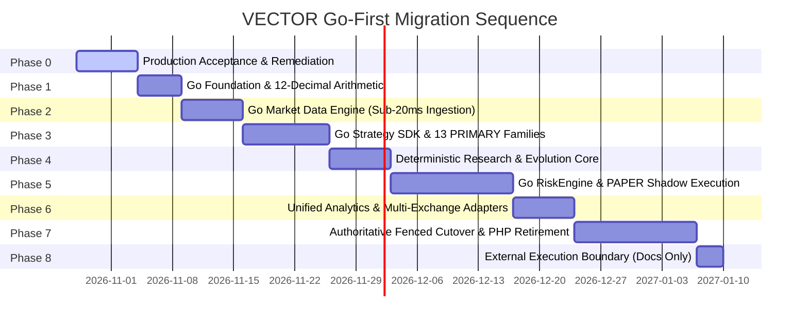

# VECTOR Go Migration Registry V3.3

**Status:** Proposed Scope & Migration Tracking Registry
**Baseline Reference:** [`VECTOR-SCOPE-20261027-v1`](file:///home/thunder/work/traderbybit/docs/progress/baselines/VECTOR-SCOPE-20261027-v1.json) (Frozen)
**Target Architecture:** [`VECTOR_GO_FIRST_ROADMAP_V3.md`](file:///home/thunder/work/traderbybit/docs/roadmap/VECTOR_GO_FIRST_ROADMAP_V3.md) (Roadmap V3.3)

---

## 1. Governance & Dual-Metric Tracking Policy

To preserve the auditability of the platform, migration progress is tracked as an **independent dimension** alongside functional completion:

1. **Functional Implementation %:** Measures whether a trading, risk, or research capability exists and passes functional specifications (regardless of implementation language).
2. **Verification %:** Measures what fraction of functional obligations have authentic execution evidence recorded in the Scorecard.
3. **Product %:** Measures explicit human operator sign-off and production readiness.
4. **Go Migration %:** Measures the operational maturity of migrating core computational, trading, risk, and financial workloads to Go:
   - `PHP_AUTH` (0% Migration Credit): PHP is the active authoritative implementation.
   - `GO_SHADOW` (50% Migration Credit): Go implementation exists, is running in parallel shadow mode, and is validated by parity tests.
   - `GO_AUTH` (100% Migration Credit): Go is the sole authoritative writer; database fencing protects against PHP dual writes.
   - `PHP_RETIRED` (Clean Sunset): Duplicate PHP computational logic is cleanly removed from the repository.

---

## 2. Migration Value Gate Status Matrix

Every workload is assigned a Migration Value Gate (MVG) disposition based on empirical evidence:

| Workload ID | Component Name | Current Owner | Target Owner | Target Phase | MVG Status | Primary Benefit | Parity Fixture Required |
|:---|:---|:---:|:---:|:---:|:---:|:---|:---:|
| **MIG-01** | Scaled Financial Decimal (12-pl) | PHP `bcmul` / Postgres | Go `pkg/decimal` | Phase 1 | **APPROVED** | Zero-allocation bit-exact arithmetic | Randomized 1M math tests |
| **MIG-02** | Fencing Token Generator | PHP / Redis locks | Go `pkg/fencing` | Phase 1 | **APPROVED** | Prevents split-brain worker execution | Distributed concurrency test |
| **MIG-03** | Public Candle Ingestion Engine | PHP `BinanceCandleIngestion` | Go `internal/marketdata` | Phase 2 | **APPROVED** | Slashes 50ms P95 latency below 20ms | 500-candle bulk insert test |
| **MIG-04** | Market WebSocket Streaming | PHP `market-ws` CLI | Go `internal/marketdata` | Phase 2 | **APPROVED** | Lock-free candle fanout, auto-reconnect | WS disconnect & burst test |
| **MIG-05** | Technical Indicator Library | PHP `app/Indicators` | Go `pkg/indicators` | Phase 1/3 | **APPROVED** | Eliminates dual maintenance & rounding drift | Golden indicator array test |
| **MIG-06** | 8 PRIMARY Strategy Families | PHP `app/Strategy/Research` | Go `internal/strategy` | Phase 3 | **APPROVED** | Single canonical strategy source | 10k candle decision parity |
| **MIG-07** | Real-Time Signal Generator | PHP `MarketScannerService` | Go `internal/strategy` | Phase 3 | **APPROVED** | Sub-5ms concurrent signal generation | Stream comparison fixture |
| **MIG-08** | Parameter Search & Mutation | PHP `StrategyEvolutionService`| Go `internal/research` | Phase 4 | **APPROVED** | Tightly coupled with backtest loop | Deterministic RNG test |
| **MIG-09** | Portfolio Risk Engine | PHP `RiskEngine.php` | Go `internal/paper/risk`| Phase 5 | **APPROVED** | Eliminates 15m polling lag | Risk limit boundary test |
| **MIG-10** | Position Lifecycle State Machine| PHP `PositionLifecycleService`| Go `internal/paper` | Phase 5 | **APPROVED** | Concurrent multi-account execution | Lifecycle transition test |
| **MIG-11** | Double-Entry Paper Ledger | PHP `LedgerRecord.php` | Go `internal/paper` | Phase 5 | **APPROVED** | Database-enforced atomic single writer | Accounting identity test |
| **MIG-12** | Funding & Slippage Settlement | PHP `PositionLifecycleStageB` | Go `internal/paper` | Phase 5 | **APPROVED** | Certified 8h/4h funding calculations | Late funding settlement test |
| **MIG-13** | Multi-Exchange Public Adapters | PHP `app/Exchanges` | Go `pkg/exchange` | Phase 6 | **APPROVED** | Unified normalization & discovery | Conformance test harness |
| **MIG-14** | Performance Analytics Math | PHP `PerformanceStatistics` | Go `internal/analytics` | Phase 6 | **APPROVED** | Sub-100ms multi-account 90d metrics | Metric reconciliation test |
| **MIG-15** | Strategy Extensibility SDK | PHP Registry | Go `pkg/strategy` | Phase 3 | **APPROVED** | Dynamic descriptor onboarding in 1 file | Stub strategy registration test |
| **MIG-16** | Profitability Research Engine | PHP `ProfitabilityResearch` | Go `internal/research/profit` | Phase 4 | **APPROVED** | Sub-100ms slippage & cost attribution | Attribution reconciliation test |
| **MIG-17** | Multi-Exchange Extensibility SDK| PHP Adapters | Go `pkg/exchange` | Phase 6 | **APPROVED** | Modular onboarding of new exchanges | Stub adapter conformance test |
| **MIG-18** | Declarative Strategy Rules Engine| New capability | Go `pkg/strategy/declarative` | Phase 3 | **APPROVED** | Deterministic config-driven rule execution | Rule grammar evaluation fixture |
| **MIG-19** | Strategy Builder UI & Validator | New capability | Vue 3 / Laravel / Go schema | Phase 3/4 | **APPROVED** | Visual & JSON rule onboarding without code | Schema validation & roundtrip tests |
| **MIG-20** | Exchange Config Schema & CSV Parser| New capability | Go `pkg/exchange/config` | Phase 6 | **APPROVED** | Validated CSV onboarding with SSRF checks | Schema compliance & SSRF boundary test |
| **MIG-21** | Generic Exchange Adapter Runtime| New capability | Go `pkg/exchange/generic` | Phase 6 | **APPROVED** | Config-driven REST/WS ingestion without Go code| Adapter capability conformance test |
| **MIG-22** | Exchange Onboarding UI & Lifecycle| New capability | Vue 3 / Laravel / Go | Phase 6 | **APPROVED** | CSV upload, endpoint preview, dry-run & approval| Lifecycle state machine transition test |
| **MIG-23** | Exchange Conformance Test Harness| New capability | Go `pkg/exchange/conformance` | Phase 6 | **APPROVED** | Automated 10-criteria contract verification | Multi-exchange conformance suite |
| **MIG-24** | Historical Dataset Schema & Provenance| New capability | Go `pkg/dataset` | Phase 1/2 | **APPROVED** | Standardized manifest & SHA-256 validation | Manifest JSON serialization test |
| **MIG-25** | Secure Historical File Import & Validation | New capability | Go `internal/dataset/importer` | Phase 2 | **APPROVED** | Streaming CSV/Parquet parser & gap detection | Corrupt file & zip bomb tests |
| **MIG-26** | Dataset Storage & Versioning | New capability | Postgres / Go `internal/dataset/storage` | Phase 2 | **APPROVED** | Isolated historical partitions with immutable hashing | Partition isolation & immutability test |
| **MIG-27** | Research Dataset Selection & Loader | New capability | Go `internal/research/loader` | Phase 4 | **APPROVED** | Chronological data feeding & leakage protection | Lookahead leakage injection test |
| **MIG-28** | Dataset Manager UI & Quality Reporting | New capability | Vue 3 / Laravel / Go | Phase 2 | **APPROVED** | Upload wizard, column mapping & quality reports | UI upload & mapping roundtrip test |
| **MIG-29** | Multi-Dataset Research Comparison | New capability | Go `internal/research/comparison` | Phase 4/6 | **APPROVED** | Cross-dataset comparison without data contamination | Divergence & comparison suite |
| **RET-01** | REST API & Sanctum Auth | PHP Laravel | PHP Laravel | Retained | **RETAINED** | Excellent, maintainable thin API | API contract tests |
| **RET-02** | Candidate Lab Promotion Gate | PHP Laravel | PHP Laravel | Retained | **RETAINED** | Human operator approval workflow | Promotion policy tests |
| **RET-03** | Operational Dashboard UI | Vue 3 / Quasar | Vue 3 / Quasar | Retained | **RETAINED** | High usability, zero trading keys | Frontend component tests |

---

## 3. Migration Sequence and Gating Milestones

---

## 4. Rollback and Disaster Recovery Protocol

In the event of an operational defect during Phase 5 (Shadow) or Phase 7 (Cutover):

1. **Phase 5 (Shadow Phase):**
   - Impact: Zero production impact.
   - Rollback: Terminate the Go shadow worker. Live PAPER accounts continue updating via PHP without interruption.
2. **Phase 7 (Cutover Phase):**
   - Fencing Rollback Command: Operator executes `php artisan vector:fencing:restore --epoch-increment`.
   - Database Action: Atomically resets `authoritative_writer = 'PHP_LEGACY'`, increments `fence_epoch`.
   - Go Action: Go daemon immediately receives fencing error on next write attempt, enters read-only standby mode.
   - PHP Action: Laravel queue workers resume order servicing.
   - Financial Continuity: Historical ledger entries created by Go remain permanently valid. No database restores from old backups are ever permitted.
