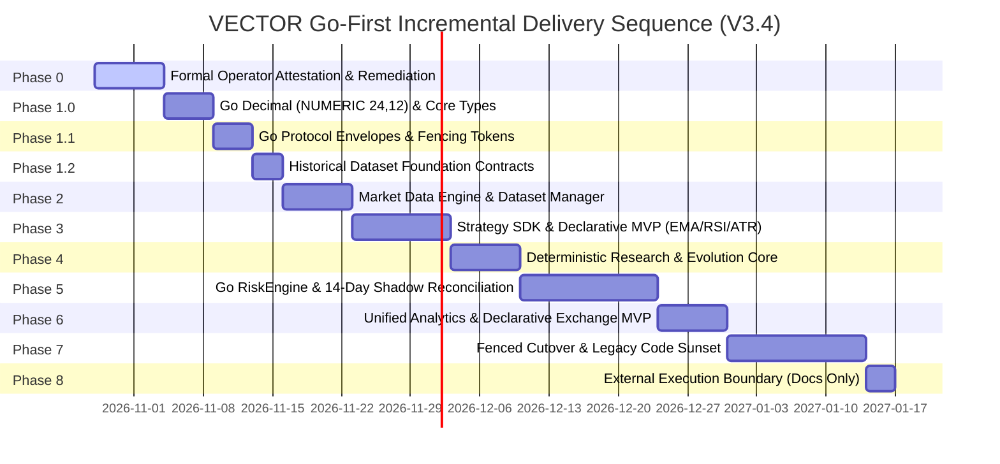

# VECTOR Go Migration Registry V3.4: Incremental Delivery & Engineering Governance

**Status:** Authoritative Migration Tracking Registry (Frozen Baseline Intact)
**Document Version:** V3.4 (Authoritative Engineering Specification)
**Baseline Reference:** [`VECTOR-SCOPE-20261027-v1`](file:///home/thunder/work/traderbybit/docs/progress/baselines/VECTOR-SCOPE-20261027-v1.json) (Frozen, 97 Requirements, 229 Obligations)
**Target Architecture:** [`VECTOR_GO_FIRST_ROADMAP_V3.md`](file:///home/thunder/work/traderbybit/docs/roadmap/VECTOR_GO_FIRST_ROADMAP_V3.md) (Roadmap V3.4)

---

## 1. Governance, Atomic Synchronization & Tracking Policy

To preserve the absolute auditability and mathematical integrity of the platform, migration progress is tracked as an **independent dimension** alongside functional completion:

1. **Functional Implementation %:** Measures whether a trading, risk, or research capability exists and passes functional specifications (regardless of implementation language).
2. **Verification %:** Measures what fraction of functional obligations have authentic execution evidence recorded in the Scorecard.
3. **Product %:** Measures explicit human operator sign-off and production readiness.
4. **Go Migration %:** Measures the operational maturity of migrating core computational, trading, risk, and financial workloads to Go across six distinct states:
   - `APPROVED`: Architectural scope, design contracts, and acceptance criteria approved by the architecture board; runtime implementation not started (0% Migration Credit). **`APPROVED` strictly does NOT imply, and must never be conflated with, `GO_IMPLEMENTED`, `GO_SHADOW`, or `GO_AUTH`.**
   - `PHP_AUTH`: PHP is the active authoritative implementation (0% Migration Credit).
   - `GO_IMPLEMENTED`: Go code implemented, tested, and passing unit/benchmark tests, but not yet verified in operational parallel shadow mode (25% Migration Credit).
   - `GO_SHADOW`: Go implementation exists, runs concurrently in parallel shadow mode, and is verified by differential parity tests without write authority (50% Migration Credit).
   - `GO_AUTH`: Go is the sole authoritative writer; database fencing triggers strictly protect against dual writes (100% Migration Credit).
   - `PHP_RETIRED`: Duplicate legacy PHP computational logic is cleanly decommissioned and removed from the repository (Clean Sunset).

5. **Mandatory Atomic Synchronization Rule:**
   Whenever a migration package's implementation maturity or ownership changes, this authoritative migration registry **MUST be updated in the exact same Git commit** as the relevant code implementation change.
   - Documentation-only amendments do not constitute implementation progress and must never alter maturity states.
   - No automatic promotion of maturity status based on test counts alone.
   - Same-commit source and registry consistency is enforced via Git history and CI verification (`scripts/verify_migration_registry.py`). A commit is **not** required to contain its own SHA within the commit payload; instead, CI inspects `git log` and the commit changeset to verify that any code changes transitioning package maturity include the corresponding registry update in that exact same commit.

6. **Scope vs Verification Distinction:**
   `APPROVED ARCHITECTURAL SCOPE != IMPLEMENTED RUNTIME CAPABILITY`. Planned migration packages (`MIG-18` through `MIG-29`) represent approved planned architecture milestones, not completed implementations. During this documentation amendment, all packages retain their uninflated baseline maturity states. Phase 0 status remains strictly **BLOCKED**; Phase 1 remains **NOT STARTED**.

7. **Required Registry Field Schema:**
   Every workload package in the registry maintains the following canonical fields:
   - `Package ID`: Stable unique identifier (`MIG-01` through `MIG-29`).
   - `Current Scope`: Precise functional and boundary description.
   - `Owner`: Authoritative subsystem owner (`PHP`, `Go Core`, `Go Research`, `PostgreSQL`).
   - `Phase & Increment`: Explicit phase assignment (`Phase 1.0`, `Phase 1.1`, `Phase 1.2`, `Phase 2`, `Phase 3 MVP`, etc.).
   - `Actual Implementation Maturity`: One of the six defined maturity states.
   - `Supporting Source Paths`: Verified repository files and packages.
   - `Verification Evidence`: File hashes, benchmark logs, and test run references.
   - `Promotion Git Ref / Baseline Commit`: Historical Git ref or baseline SHA where current maturity was verified (for already-promoted components), without requiring in-flight commits to self-reference their own SHA.
   - `Acceptance Status`: `PENDING`, `LOCAL_VERIFIED`, `ACCEPTED`, `BLOCKED`.
   - `Unresolved Blockers`: Active impediments preventing promotion.
   - `Next Promotion Gate`: Objective criteria required for next maturity transition.

---

## 2. Migration Value Gate Status Matrix

Every workload is assigned a Migration Value Gate (MVG) disposition based on empirical evidence and incremental delivery boundaries:

| Workload ID | Component Name | Current Owner | Target Owner | Target Phase | MVG Status | Primary Benefit | Parity Fixture Required |
|:---|:---|:---:|:---:|:---:|:---:|:---|:---:|
| **MIG-01** | Scaled Financial Decimal (12-pl) | PHP `bcmul` / Postgres | Go `pkg/decimal` | Phase 1.0 | **APPROVED** | Zero-allocation bit-exact arithmetic compatible with `NUMERIC(24,12)` | Randomized 1M batched PostgreSQL math tests |
| **MIG-02** | Fencing Token Generator | PHP / Redis locks | Go `pkg/fencing` | Phase 1.1 | **APPROVED** | Prevents split-brain worker execution under monotonic epochs | Distributed concurrency race test |
| **MIG-03** | Public Candle Ingestion Engine | PHP `BinanceCandleIngestion` | Go `internal/marketdata` | Phase 2 | **APPROVED** | Slashes 50ms P95 latency below 20ms | 500-candle bulk insert test |
| **MIG-04** | Market WebSocket Streaming | PHP `market-ws` CLI | Go `internal/marketdata` | Phase 2 | **APPROVED** | Lock-free candle fanout, auto-reconnect | WS disconnect & burst test |
| **MIG-05** | Technical Indicator Library | PHP `app/Indicators` | Go `pkg/indicators` | Phase 1.0/3 | **APPROVED** | Eliminates dual maintenance & rounding drift | Golden indicator array test |
| **MIG-06** | 8 PRIMARY Strategy Families | PHP `app/Strategy/Research` | Go `internal/strategy` | Phase 3 | **APPROVED** | Single canonical strategy source | 10k candle decision parity |
| **MIG-07** | Real-Time Signal Generator | PHP `MarketScannerService` | Go `internal/strategy` | Phase 3 | **APPROVED** | Sub-5ms concurrent signal generation | Stream comparison fixture |
| **MIG-08** | Parameter Search & Mutation | PHP `StrategyEvolutionService`| Go `internal/research` | Phase 4 | **APPROVED** | Tightly coupled with backtest loop | Deterministic RNG test |
| **MIG-09** | Portfolio Risk Engine | PHP `RiskEngine.php` | Go `internal/paper/risk`| Phase 5 | **APPROVED** | Eliminates 15m polling lag | Risk limit boundary test |
| **MIG-10** | Position Lifecycle State Machine| PHP `PositionLifecycleService`| Go `internal/paper` | Phase 5 | **APPROVED** | Concurrent multi-account execution | Lifecycle transition test |
| **MIG-11** | Double-Entry Paper Ledger | PHP `LedgerRecord.php` | Go `internal/paper` | Phase 5 | **APPROVED** | Database-enforced atomic single writer | Accounting identity test ($0.000000000000$ diff) |
| **MIG-12** | Funding & Slippage Settlement | PHP `PositionLifecycleStageB` | Go `internal/paper` | Phase 5 | **APPROVED** | Certified 8h/4h funding calculations | Late funding settlement test |
| **MIG-13** | Multi-Exchange Public Adapters | PHP `app/Exchanges` | Go `pkg/exchange` | Phase 6 | **APPROVED** | Unified normalization & discovery | Conformance test harness |
| **MIG-14** | Performance Analytics Math | PHP `PerformanceStatistics` | Go `internal/analytics` | Phase 6 | **APPROVED** | Sub-100ms multi-account 90d metrics | Metric reconciliation test |
| **MIG-15** | Strategy Extensibility SDK | PHP Registry | Go `pkg/strategy` | Phase 3 | **APPROVED** | Dynamic descriptor onboarding in 1 file | Stub strategy registration test |
| **MIG-16** | Profitability Research Engine | PHP `ProfitabilityResearch` | Go `internal/research/profit` | Phase 4 | **APPROVED** | Sub-100ms slippage & cost attribution | Attribution reconciliation test |
| **MIG-17** | Multi-Exchange Extensibility SDK| PHP Adapters | Go `pkg/exchange` | Phase 6 | **APPROVED** | Modular onboarding of new exchanges | Stub adapter conformance test |
| **MIG-18** | Declarative Strategy Rules Engine MVP| New capability | Go `pkg/strategy/declarative` | Phase 3 MVP | **APPROVED** | Deterministic rule execution (EMA, RSI, ATR; GT/LT; AND/OR) | Rule grammar evaluation fixture against native Go |
| **MIG-19** | Strategy Builder UI & Validator MVP | New capability | Vue 3 / Laravel / Go schema | Phase 3/4 MVP | **APPROVED** | JSON rule onboarding without code or dynamic `eval` | Schema validation & roundtrip tests |
| **MIG-20** | Exchange Config Schema & CSV Parser MVP| New capability | Go `pkg/exchange/config` | Phase 6 MVP | **APPROVED** | Minimal CSV mapping in isolated research scope | Schema compliance & SSRF boundary test |
| **MIG-21** | Generic Exchange Adapter Runtime MVP| New capability | Go `pkg/exchange/generic` | Phase 6 MVP | **APPROVED** | Config-driven ingestion strictly barred from live PAPER | Adapter capability conformance test |
| **MIG-22** | Exchange Onboarding UI & Lifecycle MVP| New capability | Vue 3 / Laravel / Go | Phase 6 MVP | **APPROVED** | CSV upload, endpoint preview, and research approval | Lifecycle state machine transition test |
| **MIG-23** | Exchange Conformance Test Harness | New capability | Go `pkg/exchange/conformance` | Phase 6 | **APPROVED** | Automated 10-criteria contract verification | Multi-exchange conformance suite |
| **MIG-24** | Historical Dataset Schema & Provenance| New capability | Go `pkg/dataset` | Phase 1.2 | **APPROVED** | Standardized manifest & SHA-256 validation types | Manifest JSON serialization test |
| **MIG-25** | Secure Historical File Import & Validation | New capability | Go `internal/dataset/importer` | Phase 2 | **APPROVED** | Bounded streaming parser & zero silent conflict checks | Corrupt file, bomb & conflict tests |
| **MIG-26** | Dataset Storage & Versioning | New capability | Postgres / Go `internal/dataset/storage` | Phase 2 | **APPROVED** | Isolated historical partitions with immutable hashing | Partition isolation & immutability test |
| **MIG-27** | Research Dataset Selection & Loader | New capability | Go `internal/research/loader` | Phase 4 | **APPROVED** | Chronological data feeding & leakage protection | Lookahead leakage injection test |
| **MIG-28** | Dataset Manager UI & Quality Reporting | New capability | Vue 3 / Laravel / Go | Phase 2 | **APPROVED** | Upload wizard, column mapping & quality reports | UI upload & mapping roundtrip test |
| **MIG-29** | Multi-Dataset Research Comparison | New capability | Go `internal/research/comparison` | Phase 4/6 | **APPROVED** | Cross-dataset comparison without data contamination | Divergence & comparison suite |
| **RET-01** | REST API & Sanctum Auth | PHP Laravel | PHP Laravel | Retained | **RETAINED** | Excellent, maintainable thin API control plane | API contract tests |
| **RET-02** | Candidate Lab Promotion Gate | PHP Laravel | PHP Laravel | Retained | **RETAINED** | Human operator approval workflow | Promotion policy tests |
| **RET-03** | Operational Dashboard UI | Vue 3 / Quasar | Vue 3 / Quasar | Retained | **RETAINED** | High usability, zero trading keys | Frontend component tests |

---

## 3. Migration Sequence and Incremental Gating Milestones

---

## 4. Rollback and Disaster Recovery Protocol

In the event of an operational defect during Phase 5 (Shadow) or Phase 7 (Cutover):

1. **Phase 5 (Shadow Phase):**
   - Impact: Zero production impact. Authoritative ledger remains 100% in PHP.
   - Divergence Handling: Diagnostic tool `cmd/vector-reconcile` identifies first divergent event.
   - Timer Reset: Any material unexplained financial divergence restarts the 14-day continuous validation timer from zero (Day 0).
   - Rollback: Terminate the Go shadow worker. Live PAPER accounts continue updating via PHP without interruption.
2. **Phase 7 (Cutover Phase):**
   - Fencing Rollback Command: Operator executes `php artisan vector:fencing:restore --epoch-increment`.
   - Database Action: Atomically resets `authoritative_writer = 'PHP_LEGACY'`, increments `fence_epoch`.
   - Go Action: Go daemon immediately receives fencing rejection on next write attempt, transitions to read-only standby.
   - PHP Action: Laravel queue workers resume order servicing under the incremented epoch.
   - Financial Continuity: Historical ledger entries created by Go remain permanently valid. No database restores from old backups are ever permitted.

---

## 5. Lightweight Automated Drift Check Specification

To enforce the atomic synchronization rule automatically in CI workflows:

1. **Script Contract:** `scripts/verify_migration_registry.py --check-drift`
2. **Verification Predicates:**
   - Evaluates the commit changeset via `git log` and diff history without requiring a commit to contain its own SHA.
   - Detects all commits modifying paths matching `pkg/` or `internal/` or `app/Strategy/` or `app/Indicators/`.
   - Confirms that any commit transitioning a package maturity state includes corresponding updates to `docs/progress/VECTOR_GO_MIGRATION_REGISTRY_V3.md` in that exact same commit.
   - Verifies that packages marked `GO_IMPLEMENTED`, `GO_SHADOW`, or `GO_AUTH` have existing, compilable Go source files in their declared `Supporting Source Paths`.
   - Asserts that no documentation-only commit inflates migration maturity metrics.
3. **Failure Policy:** Fails with exit code 1 if drift or unverified maturity claims are detected.
