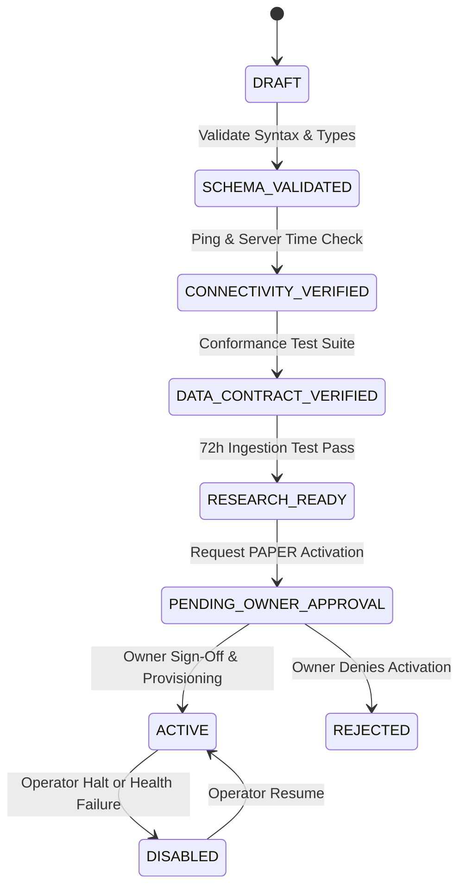

# VECTOR Go-First Architecture Roadmap V3.2: Declarative Exchange & Strategy Builders

**Document Version:** V3.2 (Authoritative Engineering Specification)
**Status:** Canonical Approved Technical Roadmap & Architecture Plan
**Governing Standards:** [`AGENTS.md`](file:///home/thunder/work/traderbybit/AGENTS.md) and [`SKILL.md`](file:///home/thunder/work/traderbybit/SKILL.md)
**Source Baseline SHA:** `9f1d94b1da94b159b32ad71cb7646da490332e2b` (Roadmap V3.1 Baseline)
**Historical Scope Baseline:** `VECTOR-SCOPE-20261027-v1` (Frozen, 97 Requirements, 229 Obligations)
**Target Proposal Baseline:** `VECTOR-SCOPE-20261028-v3.2`
**Execution Mode:** STRICTLY VIRTUAL PAPER TRADING ONLY. Zero real exchange trading; zero private trade credentials; zero order placement endpoints.

---

## Executive Summary & Owner Directives

The owner and architecture board have codified the primary architectural trajectory for the VECTOR research and virtual paper-trading platform:

> **"Golang will become the primary language for VECTOR's core computational, quantitative research, strategy evaluation, market data, risk management, PAPER trading, and financial business logic.**
> **Laravel will remain a thin control plane responsible for API endpoints, authentication, task orchestration, configuration management, and read-side delivery of statistics.**
> **Vue 3 + Quasar remains the frontend dashboard and observability layer.**
> **We optimize VECTOR for measurable efficiency, maintainability, reliability, security, and functional progress — NOT for code deletion, language migration percentages, or rewriting the same project repeatedly.**
> **VECTOR must evolve from a fixed collection of 13 trading strategies on two exchanges into an extensible, configuration-driven quantitative research platform.**
> **To enable rapid, low-cost extension without requiring custom programming or an embedded LLM, VECTOR will support declarative exchange onboarding via validated CSV templates and declarative strategy authoring via validated rule configurations and UI builders.**
> **When an exchange API or strategy logic exceeds declarative capabilities, the platform cleanly falls back to native Go SDK implementations.**
> **VECTOR does NOT require an LLM, AI agent, or external token consumption for trading, evaluation, or normal operations."**

### Core Engineering Principles
1. **Declarative First, SDK Fallback:** Common REST/WebSocket cryptocurrency perpetual exchanges and indicator-based strategies should be onboardable via declarative schemas without generating code. Unusually complex or non-standard protocols fall back to native versioned Go SDK implementations.
2. **Zero Mandatory LLM / No AI Trade Decisions:** The platform operates with 100% determinism. No LLM credentials, embedded agents, prompt injections, or external token costs exist in the trading, market data, evaluation, or accounting execution paths. External AI tools (e.g. Codex) may be used offline by developers to generate code or configurations, but the runtime remains strictly deterministic.
3. **Dual Certification — Correctness vs Profitability:** Technical correctness (flawless execution, zero lookahead, deterministic calculations, accounting reconciliation) is strictly separated from economic profitability (net R-multiples, slippage drag, fee decay, drawdown, and statistical stability). An operationally sound strategy may be unprofitable; a backtest-profitable strategy may be statistically fragile. Neither condition is ever obscured.
4. **Single Authoritative Writer:** To guarantee absolute financial integrity across all independent PAPER accounts, at any given millisecond exactly **ONE** engine is the authoritative writer for any given financial or ledger entity. Dual-writing is strictly prohibited. Fencing tokens and monotonic epochs enforce this invariant in PostgreSQL.
5. **Efficiency Over Migration for Its Own Sake:** Workload migration must be justified by empirical performance gains (throughput, latency, memory bounds, mathematical determinism). Arbitrary code deletion goals (e.g. "remove 40% of PHP code") are permanently revoked.
6. **Strict Safety Invariants:** Virtual PAPER mode only; zero real exchange orders; zero trade credentials; preserved 5% entry-block and 10% halt risk thresholds; preserved independent account isolation; zero historical financial record mutation; ECONOM resources strictly untouched.

---

## Roadmap V3.2 Change Log & Superseded Requirements

### What Changed in Roadmap V3.2 (from V3.1)
1. **Declarative Exchange Onboarding (Phase 6 & Section 7):**
   - Added a work package for the **Declarative Exchange Builder / CSV Configuration Import**.
   - Defined the canonical Exchange Configuration Schema covering Identity, REST endpoints, WebSocket subscriptions, Market Data field mappings, Instrument specifications, and Funding/Cost schedules.
   - Established the untrusted CSV import format (`schema_version,section,key,value`) converted internally into strongly typed Go structs.
   - Specified strict security boundaries: SSRF prevention, allowlisted domains, rejection of loopback/private/internal IP addresses, DNS checks, file size limits, and zero credentials.
   - Defined the 10-state Exchange Lifecycle (`DRAFT` $\rightarrow$ `ACTIVE`) and fail-closed error handling (`REQUIRES_CUSTOM_ADAPTER` on unrepresentable APIs).
2. **Declarative Strategy Onboarding (Phase 3 & Section 6):**
   - Introduced three strategy creation modes: **Mode A (Native Go Strategy)**, **Mode B (Declarative Strategy Configuration)**, and **Mode C (Visual Strategy Builder in UI)**.
   - Defined the canonical Declarative Strategy Schema specifying indicator parameters, condition groups (AND/OR), crossovers, threshold comparators, and risk-compatible position plans.
   - Created the registry of approved primitives and the fail-closed fallback (`REQUIRES_CUSTOM_STRATEGY` on unrepresentable logic).
   - Specified that declarative strategies compile into identical `StrategyDecision` contracts and run through the backtest and research engines identically to native Go strategies.
3. **No Mandatory LLM Architectural Invariant:**
   - Explicitly codified that VECTOR core does not require OpenAI/Claude API keys, local LLMs, GPU runtimes, or AI agent decision-making. AI-assisted authoring remains an optional developer-side tool outside the runtime boundary.
4. **Migration Registry Updates:**
   - Added work packages `MIG-18` through `MIG-23` in `VECTOR_GO_MIGRATION_REGISTRY_V3.md` tracking the declarative builder components.

### What Changed in Roadmap V3.1 (from V3.0)
1. **Dynamic Extensibility Model:** Replaced hardcoded assumptions of "13 strategies and 2 exchanges" with versioned Strategy SDK and Exchange SDK architectures ($N$ strategies $\times$ $M$ exchanges = $N \times M$ accounts).
2. **PROFIT-1 Research & Quantitative Intelligence:** Added independent slippage attribution, risk-adjusted performance (ESS, uncertainty bounds), cost structure decomposition, portfolio concentration analysis, and quarantined counterfactual rejected-signal replay.
3. **Autonomous Research Loop:** Formalized a 16-step autonomous experimentation loop with human owner approval for PRIMARY trading changes.
4. **Phase 0 Status Realignment:** Synchronized Phase 0 with commit `8e04eba` (42 local V1 PASS, 9 browser V3 PASS, 45 production V2 pending operator execution).

### Obsolete Requirements Explicitly Superseded
- **Superseded:** The obsolete 8 PRIMARY + 5 RESEARCH_CANDIDATE split. **Authoritative Rule:** All 13 strategy families are PRIMARY production strategies on Bybit and Binance.
- **Superseded:** Hardcoded 13-strategy and 2-exchange architectural limits. **Authoritative Rule:** 13 $\times$ 2 is the active portfolio baseline; the Go Core engine supports dynamic multi-strategy and multi-exchange topology.
- **Superseded:** Mandatory code generation for every new exchange or strategy. **Authoritative Rule:** Common standard interfaces are onboarded declaratively via CSV/JSON configurations without writing Go code.
- **Superseded:** Arbitrary "40% Laravel code reduction" target. **Authoritative Rule:** Replaced with objective empirical performance metrics (P95 ingestion < 20ms, lifecycle < 15ms, zero accounting discrepancy).
- **Superseded:** Uncontrolled autonomous promotion of research candidates to live trading. **Authoritative Rule:** Research is autonomous; PAPER promotion requires explicit owner authorization and account provisioning.
- **Superseded:** Premature phase transition while Phase 0 is incomplete. **Authoritative Rule:** Phase 0 remains strictly BLOCKED until operator production checklist evidence is recorded; Phase 1 remains NOT STARTED.

---

## 1. Repository Inspection & Workload Classification

An exhaustive inspection of `/home/thunder/work/traderbybit` classifies every major system workload into its current implementation state:

| Workload Area | Current Implementation & Location | Operational Status | Migration Strategy | Target Phase |
|:---|:---|:---|:---|:---:|
| **Deterministic Backtesting** | Go: `research-go/internal/backtest/` | **Active in Go** via leased `research-worker`. High throughput. | **REUSE & EXTEND** (Support all 13 families + declarative strategies). | Phase 4 |
| **Walk-Forward Optimization (WFO)** | Go: `research-go/internal/walkforward/` | **Active in Go** via `WFOEvaluator`. Causal splits intact. | **REUSE** (Tested, causal splitting intact). | Phase 4 |
| **Monte Carlo Simulation** | Go: `research-go/internal/simulation/` | **Active in Go** (10k+ path block bootstrap). Zero allocations. | **REUSE** (High throughput, zero allocations). | Phase 4 |
| **Leased Worker Orchestration** | Go: `research-go/internal/jobrunner/` | **Active in Go** (`FOR UPDATE SKIP LOCKED`). Heartbeats active. | **REUSE** (Durable lease heartbeats). | Phase 4 |
| **Pattern & Breakout Mining** | Go: `research-go/internal/patterns/` | **Implemented in Go**, standalone capability. | **REUSE & INTEGRATE**. | Phase 4 |
| **Decision Replay & Attribution** | Go: `research-go/internal/replay/` | **Implemented in Go**, counterfactual replay runner. | **REUSE & EXTEND**. | Phase 4 |
| **Candidate Strategies (5 Families)**| Go: `research-go/internal/candidates/` | **Implemented in Go**, candidate contract tests passing. | **STANDARDIZE** into Go Strategy SDK. | Phase 3 |
| **PRIMARY Strategies (13 Families)**| PHP: `app/Strategy/Research/` | **Implemented in PHP**. Scoped by exchange in Backtest/PAPER. | **MIGRATE & CONSOLIDATE** into Go Strategy SDK. | Phase 3 |
| **Declarative Strategy Engine** | Planned: Go `pkg/strategy/declarative` | **New in V3.2**. Evaluates JSON/CSV rule definitions. | **IMPLEMENT** in Go Strategy SDK. | Phase 3 |
| **Technical Indicators** | PHP (`app/Indicators/`) & Go (`algorithms/`) | **Duplicated math across PHP and Go**. | **CONSOLIDATE** into shared Go package. | Phase 1 & 3 |
| **Candle Ingestion & WS Streaming** | PHP: `BinanceCandleIngestion`, Artisan WS | **Implemented in PHP**. Bottleneck (P95 50.49ms on 500 rows). | **MIGRATE** to Go Market Data Engine. | Phase 2 |
| **Generic Config-Driven Adapter** | Planned: Go `pkg/exchange/generic` | **New in V3.2**. Parses CSV exchange templates. | **IMPLEMENT** in Go Multi-Exchange SDK. | Phase 6 |
| **Portfolio Risk Engine** | PHP: `app/PaperTrading/Application/RiskEngine.php` | **Implemented in PHP**. Polling queue execution. | **MIGRATE** to Go Core (Phase 5 Shadow, Phase 7 Cutover). | Phase 5 |
| **Position Lifecycle State Machine**| PHP: `PositionLifecycleService.php` | **Implemented in PHP**. Sequential account loops. | **MIGRATE** to Go Core (Phase 5 Shadow, Phase 7 Cutover). | Phase 5 |
| **Double-Entry Financial Accounting**| PHP: `LedgerRecord.php`, `DailyPerformanceService.php` | **Implemented in PHP**. System of record in PostgreSQL. | **MIGRATE** to Go Core (Phase 5 Shadow, Phase 7 Cutover). | Phase 5 |
| **Multi-Exchange Adapters** | PHP: `app/Exchanges/` | **Implemented in PHP** (Bybit & Binance). | **CONSOLIDATE** into unified Go Exchange SDK. | Phase 6 |
| **REST API, Auth & Control Plane** | PHP: Laravel 11/13 + Sanctum | **Implemented in PHP**. Operating effectively as Web API. | **RETAIN IN PHP** (Thin Control Plane). | Control Plane |
| **Vue 3 Operational Dashboard** | TypeScript / Vue 3 / Quasar | **Browser SPA**. Clean observability, zero trading keys. | **RETAIN** (Decoupled Frontend). | Frontend |

---

## 2. Core Target Architecture & Extensibility Vision

### 2.1 Decoupled Architecture & Process Model

VECTOR enforces a clean separation of concerns between control plane orchestration and high-performance quantitative execution:

```
┌────────────────────────────────────────────────────────────────────────┐
│               LARAVEL THIN CONTROL PLANE & WEB UI                     │
│  - Authentication, Roles, Session Management (Sanctum)                │
│  - REST API Routing & Request Validation (`/api/v1/...`)               │
│  - Declarative Builders UI: Exchange CSV Upload & Visual Strategy UI  │
│  - Operator Governance: Promotion Approvals, Kill-Switch Controls      │
│  - Asynchronous Research Job Submission & Experiment Visualization     │
│  - Read-Side Delivery: Ledgers, Statistics, CSV & ZIP Audit Archives   │
│  - Quasar 2 / Vue 3 Operational Dashboards (Strict Observability)      │
└───────────────────────────────┬────────────────────────────────────────┘
                                │ Redis Streams (Async Events & Signals)
                                │ PostgreSQL 17 (Durable System of Record)
┌───────────────────────────────▼────────────────────────────────────────┐
│                        GOLANG VECTOR CORE                              │
│                                                                        │
│  ┌───────────────────────┐  ┌───────────────────────────────────────┐  │
│  │   Market Data Engine  │  │         Strategy Runtime SDK          │  │
│  │  - Native WS Adapters │  │  - Native Go Strategies (Mode A)      │  │
│  │  - Config-Driven (CSV)│  │  - Declarative Rules Engine (Mode B/C)│  │
│  │  - Normalized Candles │  │  - Extensible Strategy Registry       │  │
│  │  - Server-Time Sync   │  │  - Bit-Exact Parity Golden Fixtures   │  │
│  │  - Sub-15ms Ingestion │  │  - Concurrent Real-Time Evaluation    │  │
│  └───────────┬───────────┘  └───────────────────┬───────────────────┘  │
│              │                                  │                      │
│  ┌───────────▼──────────────────────────────────▼───────────────────┐  │
│  │               PAPER Trading & Risk Engine Core                   │  │
│  │  - Multi-Account Topology ($N$ Strategies $\times$ $M$ Exchanges) │  │
│  │  - Deterministic Position State Machine (Pending->Open->TP->Closed)│
│  │  - Certified Funding Rates (8h/4h) & Taker Slippage Settlement   │  │
│  │  - Double-Entry Financial Accounting (Exact 12-Decimal Math)     │  │
│  │  - Database-Enforced Single-Writer Fencing Protocol              │  │
│  └───────────────────────────────────┬──────────────────────────────┘  │
│                                      │                                 │
│  ┌───────────────────────────────────▼──────────────────────────────┐  │
│  │              Research & Deterministic Evolution                  │  │
│  │  - Leased Compute Runner (`research-worker`, `FOR UPDATE SKIP`)  │  │
│  │  - Vectorized Backtesting, Walk-Forward, Monte Carlo Simulation  │  │
│  │  - Profitability Intelligence: Slippage, Costs, Concentration    │  │
│  │  - Autonomous Pattern Discovery & Mutation Trees                 │  │
│  └──────────────────────────────────────────────────────────────────┘  │
└────────────────────────────────────────────────────────────────────────┘
```

### 2.2 Resource, Service, and Storage Topography
- **Zero Service Proliferation:** Go execution is organized into **two bounded processes**:
  1. `vector-core`: Single-process, multi-goroutine daemon handling Market Data Ingestion (native + generic config adapters), Strategy Evaluation (native + declarative engines), Risk Management, and PAPER Lifecycle.
  2. `research-worker`: Scalable batch compute worker executing heavy asynchronous research workloads (`BACKTEST`, `WFO`, `MONTE_CARLO`, `EVOLVE`, `MINE_PATTERNS`).
- **Persistence Roles:**
  - **PostgreSQL 17:** Single source of truth for accounts, positions, executions, double-entry journals, audit events, exchange configurations, declarative rule sets, and research manifests.
  - **Redis 7.4:** In-memory tick buffers, fast snapshot cache, and ephemeral IPC streams. **Never** the authoritative store for balances.

### 2.3 Forward-Compatible Scalability Model ($N$ Strategies $\times$ $M$ Exchanges)
The platform scales dynamically through two parallel paths:
- **Declarative Path:** New standard perpetual exchanges and indicator-based strategies are onboarded via CSV/JSON configurations without writing or compiling code.
- **Native SDK Path:** Unusually complex exchanges or algorithmic strategies are implemented via Go SDK interfaces.
- **Account Isolation:** Each account is strictly partitioned by `(exchange_id, strategy_id)`. Cross-account margin sharing, cross-exchange position leakage, and shared balance pools are architecturally prevented.

---

## 3. Migration Value Gate (MVG) Specification

No component is migrated simply because it is written in PHP. Every proposed workload must satisfy the **Migration Value Gate (MVG)**:

### 3.1 The 10-Point Evaluation Template
1. **Current Implementation & Ownership:** File paths, classes, and current runtime ownership.
2. **Identified Problem or Bottleneck:** Empirical latency, CPU/memory overhead, synchronization defects, or developer maintenance friction.
3. **Technical Rationale for Go:** Why Go’s type system, concurrency model, or memory layout solves the specific issue.
4. **Baseline Empirical Measurement:** Exact recorded metrics (P50/P95 latency, allocation count, failure rate).
5. **Complexity & Risk:** Lines of code touched, architectural dependencies, regression risk.
6. **Integrity & Correctness Risks:** Financial risk, race conditions, decimal truncation, or accounting divergence.
7. **Expected Measurable Improvement:** Specific verifiable target (e.g. latency, throughput, memory bounds).
8. **Shadow Parity & Rollback Strategy:** Dual-running methodology, verification period, and rollback mechanics.
9. **Acceptance Criteria:** Hard measurable thresholds required before authorizing production cutover.
10. **Formal Gate Decision:** `REUSE`, `EXTEND`, `MIGRATE`, `CONSOLIDATE`, `RETAIN`, or `DEFER`.

### 3.2 Formal Migration Value Gate Decisions

| Component Area | Current Implementation | Empirical Baseline | Bottleneck / Rationale | Decision | Target Milestone |
|:---|:---|:---|:---|:---:|:---:|
| **Binance Candle Ingestion** | PHP: `BinanceCandleIngestion` | P95 = 50.49 ms on 500 rows | PHP PDO binding & serialization overhead. Go binary unnest eliminates lag. | **MIGRATE** | Phase 2 |
| **Bybit WebSocket Listener** | PHP: `market-ws` CLI | Single-threaded ReactPHP | Socket reconnect fragility, memory drift. Go goroutines offer robust lock-free channel fanout. | **MIGRATE** | Phase 2 |
| **Deterministic Backtesting** | Go: `research-go/internal/backtest/` | Millions of bars/sec in Go | High throughput, zero GC pauses. | **REUSE** | Phase 4 |
| **WFO & Monte Carlo** | Go: `research-go/internal/` | 10k paths in < 2s | Parallel matrix operations in Go standard library. | **REUSE** | Phase 4 |
| **Technical Indicators** | PHP `app/Indicators` & Go `algorithms` | Duplicated math | Rounding drift risk. Consolidate into single Go library. | **CONSOLIDATE** | Phase 1 & 3 |
| **13 PRIMARY Strategies** | PHP `app/Strategy/Research` | 13 PHP, 5 Go candidates | Dual maintenance. Strategies must evaluate identically in research and paper trading. | **CONSOLIDATE** | Phase 3 |
| **Strategy Extensibility SDK** | PHP `StrategyRegistry.php` | Hardcoded switch dispatches | Adding a strategy requires modifying core files. Go descriptor model enables 1-file additions. | **MIGRATE** | Phase 3 |
| **Declarative Strategy Engine**| New in V3.2 | N/A (New capability) | Allows non-programmers to define strategies via UI/config without compiling code. | **IMPLEMENT** | Phase 3 |
| **Profitability Research Engine**| PHP `ProfitabilityResearchApiTest` | Multi-second aggregations | Heavy SQL joins across 26 accounts. Go streaming attribution generates reports in sub-100ms. | **MIGRATE** | Phase 4 |
| **Candidate Search & Evolution**| PHP `StrategyEvolutionService` | High memory in PHP | Parameter mutation loops separated from Go backtest create IPC overhead. | **MIGRATE** | Phase 4 |
| **RiskEngine & Position Sizing** | PHP `RiskEngine.php` | Scheduled 15m polling | Polling delays fill acknowledgment. Go in-memory evaluation responds in milliseconds. | **MIGRATE** | Phase 5 |
| **Position Lifecycle & Fills** | PHP `PositionLifecycleService` | Sequential account loops | Sequential PHP transactions on 26 accounts cause queue latency spikes during volatile bars. | **MIGRATE** | Phase 5 |
| **Double-Entry Paper Ledger** | PHP `LedgerRecord.php` | Synchronous SQL | Must reside alongside Position Lifecycle to avoid distributed multi-phase commit overhead. | **MIGRATE** | Phase 5 |
| **Multi-Exchange Adapters** | PHP `app/Exchanges` | Disparate interfaces | Bybit and Binance use different contracts. Consolidate into standardized Go Exchange SDK. | **CONSOLIDATE** | Phase 6 |
| **Generic Config-Driven Adapter**| New in V3.2 | N/A (New capability) | Allows onboarding standard exchanges via validated CSV templates without code. | **IMPLEMENT** | Phase 6 |
| **Candidate Lab Governance** | PHP `PromotionPolicyService` | Low-frequency admin action | Approval requires human operator intervention. Laravel excels at authenticated admin workflows. | **RETAIN** | Control Plane |
| **REST API & Auth** | PHP Laravel 11/13 + Sanctum | P95 < 20 ms for API | Thin presentation layer, robust ecosystem for authentication, validation, and JSON schemas. | **RETAIN** | Control Plane |
| **Vue 3 Operational Dashboard**| TypeScript / Vue 3 / Quasar | Browser client | Clean, responsive UI with zero trading keys. Fully decoupled from backend language. | **RETAIN** | Frontend |

---

## 4. Objective Efficiency Metrics (Empirical Over Code Deletion)

All arbitrary code deletion goals are permanently struck. Technical efficiency is evaluated against empirical operational metrics:

```
┌────────────────────────────────────────────────────────────────────────┐
│                   OBJECTIVE EFFICIENCY CRITERIA                        │
├─────────────────────────────────────┬──────────────────────────────────┤
│ Metric                              │ Measurement Target               │
├─────────────────────────────────────┼──────────────────────────────────┤
│ 1. Canonical Strategy Source        │ Exactly 1 Go implementation/rule │
│ 2. Binance 500-Candle Ingestion P95 │ PROPOSED < 20.0 ms (current 50ms)│
│ 3. Strategy Evaluation Latency (13) │ PROPOSED < 5.0 ms across all 13  │
│ 4. Paper Lifecycle Processing (26)  │ PROPOSED < 15.0 ms end-to-end    │
│ 5. Memory Footprint Stability       │ Bounded Go daemon RSS < 256 MiB  │
│ 6. Strategy Authoring Efficiency    │ 1 implementation OR 1 JSON config│
│ 7. Exchange Onboarding Efficiency   │ 1 validated CSV template for std │
│ 8. Financial Accounting Parity      │ 0.000000000000 discrepancy       │
│ 9. Deterministic Replay Parity      │ 100.000% bit-exact decision match│
│ 10. Profitability Report Generation │ PROPOSED < 100 ms for 90d window │
└─────────────────────────────────────┴──────────────────────────────────┘
```

---

## 5. The Nine-Phase Implementation Roadmap

Every phase follows a standardized 18-point execution contract.

---

### Phase 0 — Existing System Acceptance & Baseline Remediation

1. **Business Objective:** Complete production operational acceptance, diagnose production market data anomalies, and verify baseline integrity across all 26 PAPER accounts without altering frozen requirements.
2. **Technical Scope:** Execute production verification queries via operator checklist; diagnose Binance immutable candle conflicts; establish verified performance baselines; maintain Phase 0 gate integrity.
3. **Existing Components to Reuse:** Full test suite (922 tests, 8,202 assertions), Playwright browser suite (`scripts/verify-browser-phase0.py`), SQL diagnostics (`scripts/diagnostics/phase0_production_acceptance.sql`), operator checklist (`docs/progress/evidence/phase0-production-acceptance/OPERATOR_CHECKLIST.md`).
4. **Components to Migrate / Replace:** None. Phase 0 is strict stabilization and verification of the existing baseline.
5. **Go Packages / Services:** Performance benchmarking utilities (`research-bench`) to profile batch ingestion.
6. **Interfaces & Versioned Contracts:** Canonical envelope (`data`, `error`, `meta`), QIM health endpoints, dual kill-switch state machine.
7. **State and Event Ownership:** PostgreSQL 17 system of record; Laravel owns all authoritative writes.
8. **Dependencies:** Prerequisite for Phase 1.
9. **Implementation Work Packages:**
   - Package 0.1: Operator execution of production SQL diagnostic suite (`OPERATOR_CHECKLIST.md`).
   - Package 0.2: Structured log capture of Binance immutable candle conflicts to verify clock skew hypothesis.
   - Package 0.3: Scorecard freshness synchronization upon production evidence receipt.
10. **Exact Acceptance Criteria:**
    - All 45 Production V2 obligations verified via operator execution of `phase0_production_acceptance.sql`.
    - Zero cross-exchange position leaks across all 26 accounts.
    - Zero double-entry discrepancies (`abs(net_pnl - (gross_pnl - fees + funding)) <= 0.0001`).
    - Binance immutable observation conflict diagnosed with captured production telemetry.
    - Binance 500-candle ingestion evaluated honestly against frozen < 50.0 ms SLA.
11. **Test Requirements:** 922 backend PHP tests passing, 64 frontend tests passing, 9 browser tests passing, Pint compliant.
12. **Performance & Resource Budgets:** PHP-FPM <= 512 MiB, PostgreSQL <= 1 GiB RSS, Redis <= 256 MiB.
13. **Shadow Execution & Rollback:** Immediate rollback to commit `a4b82ea` if operational regressions occur.
14. **Security & Data Integrity:** Strictly virtual PAPER mode across 26 accounts; zero live orders; ECONOM resources untouched.
15. **Git Commit Boundaries:** Local evidence admission and scorecard refresh commits.
16. **Evidence & Scorecard Mappings:** `VEC-P0-001` through `VEC-P0-209` (45 requirements, 99 obligations).
17. **Explicit Out-of-Scope Items:** No live trading, no real order placement, no database schema breaking changes, no manual production deployments.
18. **Operator Approval Requirements:** Operator must execute checklist queries on the VPS and provide authentic execution logs.

---

### Phase 1 — Go Core Foundation, Dynamic Identity & Versioned Contracts

1. **Business Objective:** Build shared Go foundational packages, high-precision financial arithmetic, and forward-compatible domain identity contracts supporting dynamic strategy and exchange topologies.
2. **Technical Scope:** Universal domain primitives, 12-decimal-place scaled arithmetic, versioned Redis Stream envelopes, monotonic fencing token generation, and dynamic identifier schemas.
3. **Existing Components to Reuse:** `research-go/internal/decimal/`, `research-go/internal/contracts/job.go`, Redis 7.4.
4. **Components to Migrate / Replace:** Duplicate DTO definitions, status enum constants, serialization helpers.
5. **Go Packages / Services:**
   - `pkg/types`: Universal domain primitives (`ExchangeID`, `Symbol`, `Timeframe`, `Side`, `OrderState`, `AccountID`, `StrategyID`).
   - `pkg/decimal`: 12-decimal-place scaled fixed-point math (`ScaledDecimal`) guaranteeing bit-exact arithmetic with PostgreSQL `NUMERIC(24,12)`.
   - `pkg/protocol`: Versioned message envelopes (`v3.2.0`) with schema validation and cryptographic digests.
   - `pkg/fencing`: Monotonic epoch-based fencing token generator.
6. **Interfaces & Versioned Contracts:** Versioned Redis Stream message envelope: `{"v": "3.2.0", "epoch": 1042, "type": "EVENT_NAME", "payload": {...}}`.
7. **State and Event Ownership:** Redis stream namespace reservation (`vector:stream:*`); zero PostgreSQL schema mutations.
8. **Dependencies:** Requires formal Phase 0 sign-off; prerequisite for all subsequent Go components.
9. **Implementation Work Packages:**
   - Package 1.1: Scaled fixed-point arithmetic package (`pkg/decimal`) with 12 decimal places.
   - Package 1.2: Domain identity types (`pkg/types`) decoupled from hardcoded strategy/exchange counts.
   - Package 1.3: Versioned protocol envelope parser and serializer (`pkg/protocol`).
   - Package 1.4: Monotonic epoch fencing generator (`pkg/fencing`).
10. **Exact Acceptance Criteria:**
    - `ScaledDecimal` passes 1,000,000 randomized arithmetic operations against PostgreSQL `NUMERIC` without 1 ULP discrepancy.
    - IPC serialization benchmark PROPOSED < 5 microseconds per envelope.
    - Core domain types accept arbitrary valid strings for strategy and exchange IDs without code changes.
11. **Test Requirements:** Property-based testing (`testing/quick`), fuzzing of JSON/protocol decoders, Go race detector (`go test -race`).
12. **Performance & Resource Budgets:** Static binary size < 25 MB; zero heap allocations on hot-path decimal math; worker memory ceiling 64 MiB.
13. **Shadow Execution & Rollback:** Dual-parsing of contracts in PHP and Go unit tests; git revert rollback.
14. **Security & Data Integrity:** Strict compilation boundary; no reflection in hot paths; compile-time interface verification.
15. **Git Commit Boundaries:** Foundational packages and property test suite.
16. **Evidence & Scorecard Mappings:** Foundation for `VEC-P1-001` through `VEC-P1-008`.
17. **Explicit Out-of-Scope Items:** No database writes, no live networking, no strategy logic.
18. **Operator Approval Requirements:** Architecture review of binary protocol schemas.

---

### Phase 2 — Go Market Data Engine & Resilient Ingestion

1. **Business Objective:** Eliminate PHP market data ingestion bottlenecks with a high-performance, multi-exchange Go ingestion daemon utilizing exchange server-time finality.
2. **Technical Scope:** Public REST/WebSocket streaming for Bybit and Binance; server-time synchronization to prevent clock-skew immutable observation conflicts; concurrent ring buffers; direct PostgreSQL bulk insertion.
3. **Existing Components to Reuse:** Bybit v5 and Binance USDT-M public REST/WS endpoints, rate-limit policies.
4. **Components to Migrate / Replace:** `BinanceCandleIngestion.php`, `RunMarketWebSocketCommand.php`, historical candle synchronizers.
5. **Go Packages / Services:**
   - `internal/marketdata/bybit`: Resilient Bybit v5 public WebSocket client with auto-reconnect and heartbeat.
   - `internal/marketdata/binance`: Binance public WebSocket client with sequence number tracking and server-time alignment.
   - `internal/marketdata/ringbuffer`: Lock-free circular candle buffer holding 500 closed bars per symbol/timeframe.
   - `internal/marketdata/writer`: Direct PostgreSQL bulk insertion using optimized binary `COPY` / unnest queries.
6. **Interfaces & Versioned Contracts:** `MarketDataStreamer` interface emitting immutable `CandleClosedEvent` structs.
7. **State and Event Ownership:** Go becomes authoritative writer for `market_candles`, `market_funding_rates`, `market_open_interests`. Laravel cron ingestion retired.
8. **Dependencies:** Requires Phase 1; prerequisite for Phase 3 strategy runtime.
9. **Implementation Work Packages:**
   - Package 2.1: Multi-exchange WebSocket connection manager with exponential backoff and jitter.
   - Package 2.2: Server-time synchronization layer calculating clock skew $\Delta t = t_{\text{exchange}} - t_{\text{local}}$.
   - Package 2.3: Ring buffer memory structures for zero-allocation bar retrieval.
   - Package 2.4: High-throughput PostgreSQL binary writer with conflict quarantine.
10. **Exact Acceptance Criteria:**
    - 500-candle bulk ingestion PROPOSED P95 < 20.0 ms (resolving the failing 50.49 ms PHP baseline).
    - Zero dropped candles over 72 continuous hours.
    - Candle finality evaluated strictly against exchange server timestamp: $t_{\text{close}} \le t_{\text{server}}$, eliminating immutable conflicts.
11. **Test Requirements:** Mock WebSocket servers emitting malformed payloads, out-of-order candles, clock skew injections, and burst ticks.
12. **Performance & Resource Budgets:** Peak RSS < 128 MiB; CPU load < 0.2 cores under active tick streams.
13. **Shadow Execution & Rollback:** Parallel ingestion to shadow database table; hash comparison against PHP; one-switch cutover via configuration.
14. **Security & Data Integrity:** Public endpoints only; zero trading credentials; exchange rate limits enforced via token buckets.
15. **Git Commit Boundaries:** Market data engine packages, CLI daemon, and integration tests.
16. **Evidence & Scorecard Mappings:** Resolves `VEC-P0-009-V1` permanently; feeds live market stream to `VEC-P1-001` through `VEC-P1-008`.
17. **Explicit Out-of-Scope Items:** No private exchange endpoints, no orderbook L2/L3 tick streaming.
18. **Operator Approval Requirements:** Production configuration review before enabling Go ingestion daemon.

---

### Phase 3 — Extensible Go Strategy SDK & Declarative Strategy Builder

1. **Business Objective:** Implement all 13 PRIMARY strategy families in Go with bit-exact parity against PHP golden fixtures, while providing both an extensible Go SDK and a Declarative Strategy Builder (JSON/CSV configuration & UI) allowing new strategies to be onboarded without code generation.
2. **Technical Scope:** Strategy SDK interfaces (`StrategyDescriptor`, `StrategyInstance`, `StrategyRegistry`), native Go implementations of all 13 PRIMARY families, Declarative Rule Evaluation Engine (`pkg/strategy/declarative`), Visual Strategy Builder UI contracts, concurrent real-time evaluation engine, and differential testing harness.
3. **Existing Components to Reuse:** 5 Go candidate families in `research-go/internal/candidates/`, parameters in `config/strategy.php`.
4. **Components to Migrate / Replace:** Remaining 8 PHP strategy families (`BaselineStrategy`, `TrendPullbackStrategy`, `BollingerMeanReversionStrategy`, `DonchianBreakoutStrategy`, `RegimeSwitchingStrategy`, `MomentumStrategy`, `SupportResistanceBounceStrategy`, `SupportResistanceBreakoutStrategy`).
5. **Go Packages / Services:**
   - `pkg/strategy`: Universal Go Strategy SDK (`StrategyDescriptor`, `StrategyInstance`, `Evaluate(input)`).
   - `pkg/strategy/declarative`: Bounded declarative rule evaluation engine parsing JSON/CSV rule specifications.
   - `internal/strategy/primary`: All 13 PRIMARY strategy families implemented natively in Go.
   - `internal/strategy/runtime`: Concurrent strategy evaluation engine triggered instantly upon candle close events.
6. **Interfaces & Versioned Contracts:** `StrategyDecision` struct matching canonical JSON schema (BUY, SELL, SKIP with deterministic reason codes, price targets, ATR stop-loss).
7. **State and Event Ownership:** Go publishes `SignalGeneratedEvent` to Redis Stream; Laravel reads signals for UI/API display.
8. **Dependencies:** Requires Phase 2 candle stream; prerequisite for Phase 4 evolution and Phase 5 paper execution.
9. **Implementation Work Packages:**
   - Package 3.1: Strategy SDK interface specifications and registration engine.
   - Package 3.2: Implementation of the 8 remaining PRIMARY families in Go.
   - Package 3.3: Golden fixture test generator extracting 10,000 historical decisions from PHP.
   - Package 3.4: Declarative Strategy Rules Engine (`MIG-18`) and schema validator.
   - Package 3.5: Visual Strategy Builder UI contract and API endpoint in Laravel (`MIG-19`).
   - Package 3.6: Extensibility validation using a declarative test strategy (`declarative_rsi_macd_test`).
10. **Exact Acceptance Criteria:**
    - All 13 PRIMARY families implemented in Go; 100% bit-exact decision equivalence across 10,000 historical golden candle fixtures compared against PHP golden output.
    - Concurrent evaluation of all 13 families PROPOSED P95 < 5.0 ms per closed candle.
    - Declarative test strategy defined via JSON/CSV is evaluated identically by backtest and forward runtimes without generating custom Go code.
    - Unsupported strategy logic fails closed with `REQUIRES_CUSTOM_STRATEGY`.
11. **Test Requirements:** Differential testing comparing Go output against PHP output byte-for-byte; declarative rule mutation tests; boundary condition verification.
12. **Performance & Resource Budgets:** All 13 strategies evaluated concurrently in PROPOSED < 10 ms; memory allocation < 1 MiB per evaluation.
13. **Shadow Execution & Rollback:** Go runs in shadow mode emitting signals to shadow stream; diffs logged; Laravel forward scanner continues driving paper orders until Phase 5.
14. **Security & Data Integrity:** Pure function evaluation; zero I/O, network calls, or arbitrary script execution in strategy logic; deterministic RNG seeded by candle hash.
15. **Git Commit Boundaries:** Go strategy implementations committed family by family with corresponding golden fixtures.
16. **Evidence & Scorecard Mappings:** Maps to `VEC-P1-001` through `VEC-P1-008` and `MIG-18`, `MIG-19`.
17. **Explicit Out-of-Scope Items:** No automatic live account creation, no runtime shell or code execution.
18. **Operator Approval Requirements:** Sign-off on 100% parity verification results.

---

### Phase 4 — Autonomous Research, Profitability Intelligence & Evolution Engine

1. **Business Objective:** Build a high-throughput, autonomous quantitative research core that measures economic profitability honestly, explores parameter and pattern spaces, validates both native and declarative strategies, and produces evidence-backed candidate proposals requiring human governance sign-off.
2. **Technical Scope:** Vectorized backtesting, chronological WFO, block bootstrap Monte Carlo, PROFIT-1 quantitative modules (slippage attribution, cost structures, concentration, counterfactual rejected signals), Pattern Discovery, and multiplicity-adjusted LCB.
3. **Existing Components to Reuse:** `research-go/internal/backtest/`, `research-go/internal/walkforward/`, `research-go/internal/simulation/`, `research-go/internal/patterns/`.
4. **Components to Migrate / Replace:** `ProcessAutonomousLearningJob`, `EvaluateStrategyCandidateJob`, `StrategyEvolutionService`, `ProfitabilityResearchApiTest` aggregation logic.
5. **Go Packages / Services:**
   - `internal/research/profitability`: Independent slippage attribution, cost structure decomposition, and risk-adjusted metrics (mean/median net R, Profit Factor, ESS).
   - `internal/research/evolution`: Deterministic parameter exploration (grid sweeps, mutation trees) with reproducible RNG.
   - `internal/research/patterns`: Frequent itemset and sequential breakout mining across multi-timeframe regimes.
   - `internal/research/pipeline`: End-to-end candidate lifecycle orchestrator (Search -> Backtest -> WFO -> Monte Carlo -> Candidate Lab artifact).
6. **Interfaces & Versioned Contracts:** Job contract (`JobType`, `DatasetManifest`, `ParameterSpace`, `ResultManifest`); SHA-256 output hashing.
7. **State and Event Ownership:** Go worker claims `research_jobs` via PostgreSQL `FOR UPDATE SKIP LOCKED`; writes immutable result manifests.
8. **Dependencies:** Requires Phase 3 strategy runtime; prerequisite for Candidate Lab promotion.
9. **Implementation Work Packages:**
   - Package 4.1: Quantitative profitability engine (slippage, fee, and funding attribution).
   - Package 4.2: Concentration and cross-asset correlation analyzer.
   - Package 4.3: Autonomous Pattern Discovery and sequential rule mining.
   - Package 4.4: Bounded autonomous research loop and mutation tree engine supporting declarative strategies.
   - Package 4.5: Multiplicity-adjusted LCB validation with familywise error controls.
10. **Exact Acceptance Criteria:**
    - 1 year of 15m candles backtested across 13 strategies in PROPOSED < 1.5 seconds.
    - Declarative strategies evaluated with identical throughput and fidelity to native Go strategies.
    - Slippage attribution accurately isolates execution drag without double-deducting from gross PnL.
    - Zero future label leakage verified by permutation and causal cutoff tests.
    - Rejection of all candidates with nonpositive cost-adjusted expectancy or excessive drawdown (> 12%).
11. **Test Requirements:** Leakage mutation tests, identical-input replay verification, worker crash/restart lease reclamation tests, statistical null simulation.
12. **Performance & Resource Budgets:** Worker memory ceiling <= 512 MiB; CPU bounded to 1.0 core via Compose limits; report generation PROPOSED < 100 ms.
13. **Shadow Execution & Rollback:** Jobs executed asynchronously; failed jobs do not affect paper trading; leases expire cleanly.
14. **Security & Data Integrity:** Strict governance boundary: autonomous engine cannot promote candidates to PRIMARY status; promotion requires human operator approval. Zero mandatory LLM credentials.
15. **Git Commit Boundaries:** Research packages, worker CLI, and unit test suites.
16. **Evidence & Scorecard Mappings:** Maps to `VEC-P3-001` through `VEC-P3-011` (Evolution) and `VEC-P4-001` through `VEC-P4-010` (Governance).
17. **Explicit Out-of-Scope Items:** No LLM inference in trade path, no unconstrained code generation, no automated production parameter mutation.
18. **Operator Approval Requirements:** Operator review of Candidate Lab promotion proposals.

---

### Phase 5 — Extensible Go RiskEngine, PAPER Engine & Financial Accounting (Shadow Validation)

1. **Business Objective:** Implement the complete portfolio risk engine, order lifecycle state machine, and double-entry accounting in Go; support dynamic multi-account topologies ($N$ Strategies $\times$ $M$ Exchanges); run in shadow mode while PHP remains authoritative.
2. **Technical Scope:** Dynamic account mapping, deterministic position state machine, 5%/10% drawdown enforcement, double-entry financial ledger, taker fee and funding settlement, and shadow reconciliation.
3. **Existing Components to Reuse:** PostgreSQL financial schemas (`paper_positions`, `paper_executions`, `paper_account_ledgers`), risk parameters in `config/paper.php`.
4. **Components to Migrate / Replace:** `PositionLifecycleService.php`, `RiskEngine.php`, `PaperProcessingService.php`, `DailyPerformanceService.php`.
5. **Go Packages / Services:**
   - `internal/paper/risk`: Portfolio risk evaluation, max drawdown enforcement, account isolation, leverage checks.
   - `internal/paper/lifecycle`: Order state machine (Pending -> Open -> TP1/TP2 -> Closed), trailing stops, timeout liquidation.
   - `internal/paper/accounting`: Double-entry transaction ledger engine ($\text{Equity} = \text{Balance} + \text{Unrealized PnL}$).
   - `internal/paper/settlement`: Certified 8h/4h funding rate fee calculations, taker commission deductions, slippage modeling.
6. **Interfaces & Versioned Contracts:** `RiskEvaluator`, `OrderExecutor`, `LedgerService`; transactional event signatures.
7. **State and Event Ownership:** **Strict Shadow Mode.** PHP remains the sole authoritative writer to `paper_accounts`, `paper_positions`, `paper_executions`, `paper_account_ledgers`. Go writes shadow records to isolated staging tables (`shadow_paper_*`) and emits reconciliation reports.
8. **Dependencies:** Requires Phase 3 strategy signals and Phase 2 real-time candle marks; prerequisite for Phase 7 cutover.
9. **Implementation Work Packages:**
   - Package 5.1: Scalable multi-account portfolio risk engine supporting dynamic account topologies.
   - Package 5.2: Order lifecycle state machine with partial closes and deterministic SL/TP priority.
   - Package 5.3: Bit-exact double-entry accounting engine in Go (`pkg/decimal`).
   - Package 5.4: Shadow execution harness and automated ledger diff reconciliation reporter.
   - Package 5.5: Blocked strategy diagnostic service recording structured blocker evidence.
10. **Exact Acceptance Criteria:**
    - Dynamic account scaling tested with up to 80 accounts with zero cross-contamination.
    - Zero ledger discrepancies across 100,000 synthetic lifecycle events.
    - Shadow execution runs for 14 continuous days without financial divergence from PHP live ledger.
    - Blocked strategy diagnostics record exact metric, threshold, and timestamp for any risk halt.
11. **Test Requirements:** PostgreSQL concurrency race tests (`FOR UPDATE` row locking), double-funding negative controls, partial exit precision tests.
12. **Performance & Resource Budgets:** Position processing latency PROPOSED P95 < 15 ms; memory footprint < 128 MiB; zero lock contention on concurrent accounts.
13. **Shadow Execution & Rollback:** Continuous comparison of Go shadow balance vs PHP live balance; discrepancy > 0.0001 USDT raises immediate alert. Rollback is trivial since PHP remains the live writer.
14. **Security & Data Integrity:** Zero real trading keys; accounts strictly isolated; preserved 5% entry-block and 10% halt risk thresholds.
15. **Git Commit Boundaries:** Risk engine, position lifecycle engine, accounting ledger engine, and migration scripts.
16. **Evidence & Scorecard Mappings:** Direct mapping to core Phase 0 financial requirements and Phase 4 operational controls.
17. **Explicit Out-of-Scope Items:** No direct writes to live production tables during Phase 5.
18. **Operator Approval Requirements:** Review of 14-day shadow reconciliation report.

---

### Phase 6 — Extensible Multi-Exchange SDK & Declarative Exchange Onboarding

1. **Business Objective:** Implement standardized multi-exchange adapter contracts in Go and provide a Declarative Exchange Builder (CSV import & UI workflow) allowing standard cryptocurrency perpetual exchanges to be onboarded without custom code; surface high-throughput comparative analytics via Laravel API.
2. **Technical Scope:** Universal Exchange SDK (`ExchangeDescriptor`, `ExchangeAdapter`, `ExchangeRegistry`, `ExchangeCapabilities`), Generic Config-Driven Exchange Adapter (`pkg/exchange/generic`), CSV Onboarding Parser with strict SSRF validation, native Bybit/Binance adapters, third test-only exchange adapter verification, streaming financial analytics, and slippage decomposition.
3. **Existing Components to Reuse:** `MetricRegistry.php`, `ExchangeComparisonService.php`, frontend analytics views.
4. **Components to Migrate / Replace:** Performance statistics calculations, Sharpe/Sortino/Calmar math, correlation matrices, slippage attribution.
5. **Go Packages / Services:**
   - `pkg/exchange`: Unified exchange adapter interface (`Capabilities()`, `FetchKlines()`, `StreamTicks()`, `FundingSchedule()`).
   - `pkg/exchange/generic`: Generic configurable adapter executing declarative CSV/JSON exchange specifications.
   - `internal/exchange/bybit`: Standardized Bybit linear perpetual adapter.
   - `internal/exchange/binance`: Standardized Binance USDT-M perpetual adapter.
   - `internal/exchange/stub`: Test-only third exchange adapter proving generic CSV extensibility.
   - `internal/analytics`: Streaming financial metrics calculation (real-time drawdowns, win-rate by cohort, R-multiple distributions).
   - `internal/attribution`: Mark-to-market and slippage decomposition engine.
6. **Interfaces & Versioned Contracts:** Normalized multi-exchange DTOs; analytics query API contracts; Canonical Exchange Configuration Schema.
7. **State and Event Ownership:** Go maintains read-optimized analytical materialized caches in Redis; PostgreSQL remains system of record.
8. **Dependencies:** Requires Phase 5 financial accounting; prerequisite for Phase 7 cutover.
9. **Implementation Work Packages:**
   - Package 6.1: Unified Exchange SDK contracts and capability declaration system.
   - Package 6.2: Declarative Exchange Configuration Schema & CSV Parser (`MIG-20`).
   - Package 6.3: Generic Config-Driven Exchange Adapter Runtime (`MIG-21`).
   - Package 6.4: Exchange Onboarding UI, SSRF validator, and Approval Lifecycle in Laravel (`MIG-22`).
   - Package 6.5: Config-Driven Contract Conformance Test Harness (`MIG-23`).
   - Package 6.6: Standardization of Bybit and Binance adapters under the new SDK.
   - Package 6.7: Third test-only exchange onboarding via CSV template (`stub_exchange_csv`).
   - Package 6.8: High-throughput streaming analytics and comparative metric engine.
10. **Exact Acceptance Criteria:**
    - Third test-only exchange onboarded via CSV template passes complete contract conformance suite without writing custom Go code.
    - Unsupported APIs cleanly return `REQUIRES_CUSTOM_ADAPTER` without runtime failure.
    - Strict SSRF protection rejects internal, loopback, private, or metadata IPs in endpoint URLs.
    - Unified metric calculation for 26 accounts over 90 days generated in PROPOSED < 100 ms (vs 1200 ms in PHP).
11. **Test Requirements:** Multi-exchange contract conformance test suite; CSV schema fuzzing; SSRF attack vector suite; extreme market data gap/delisting simulations; unsupported capability fail-closed tests.
12. **Performance & Resource Budgets:** Analytical query response PROPOSED P95 < 50 ms; Redis cache size < 64 MiB.
13. **Shadow Execution & Rollback:** Frontend toggles between PHP and Go analytics via feature flag; zero state mutations.
14. **Security & Data Integrity:** Public market data only; zero trading credentials; CSV upload cannot execute arbitrary code or bypass owner approval.
15. **Git Commit Boundaries:** Exchange adapter packages, analytics engine, and API integration.
16. **Evidence & Scorecard Mappings:** Maps to `VEC-P2-001` through `VEC-P2-010`, `VEC-P5-001` through `VEC-P5-008`, and `MIG-20`–`MIG-23`.
17. **Explicit Out-of-Scope Items:** No live real-money order routing to any exchange.
18. **Operator Approval Requirements:** Formal owner approval required to transition any exchange from `RESEARCH_READY` to `PAPER_ELIGIBLE`.

---

### Phase 7 — Controlled Cutover & PHP Business-Logic Retirement

1. **Business Objective:** Transfer authoritative trading and financial write ownership to Go under database-enforced fencing tokens; retire duplicate PHP computational logic while maintaining Laravel as a lean control plane.
2. **Technical Scope:** Monotonic fencing epoch handover, PostgreSQL trigger enforcement, Laravel financial write revocation, Go Core daemon supervisor integration, and duplicate PHP code decommissioning.
3. **Existing Components to Reuse:** Laravel routing, auth middleware, Vue 3 frontend UI, Docker Compose deployment framework.
4. **Components to Migrate / Retire:** Decommission duplicate PHP computational logic:
   - `app/Trading/Application/TradingPipelineEventService.php`
   - `app/PaperTrading/Application/PositionLifecycleService.php`
   - `app/PaperTrading/Application/RiskEngine.php`
   - `app/Strategy/Research/` (all 13 PHP strategy implementations)
   - `app/Exchanges/Binance/BinanceCandleIngestion.php`
5. **Go Packages / Services:** Unified Go Daemon (`cmd/vector-core`) orchestrating Ingestion, Strategies, Risk, and PAPER Lifecycle as a lean, single-process, multi-goroutine binary.
6. **Interfaces & Versioned Contracts:** Laravel acts as a client/reverse-proxy to the Go daemon via lightweight local Unix Domain Socket or HTTP on localhost.
7. **State and Event Ownership:** Go becomes the **sole authoritative writer** to trading and financial tables; database-enforced fencing token prevents any PHP writes. Laravel PostgreSQL user permissions restricted to `SELECT` on financial ledgers.
8. **Dependencies:** Requires successful completion and 14-day shadow validation of Phases 1 through 6.
9. **Implementation Work Packages:**
   - Package 7.1: PostgreSQL fencing trigger deployment (`enforce_account_writer_fencing()`).
   - Package 7.2: Account-by-account cutover orchestration CLI in Laravel.
   - Package 7.3: Activation of Go daemon as primary writer.
   - Package 7.4: Verification of 14-day zero-defect continuous operation.
   - Package 7.5: Decommissioning and removal of duplicate PHP computational classes.
10. **Exact Acceptance Criteria:**
    - Go daemon running continuously for 14 days with zero crashes, zero data-loss events, and zero ledger discrepancies.
    - End-to-end candle-to-ledger latency PROPOSED P95 < 20 ms across all accounts.
    - PostgreSQL trigger rejects any attempted write with stale epoch or unauthorized writer identity.
11. **Test Requirements:** Chaos testing (PostgreSQL restart, Redis crash, network drop); continuous integrity reconciler verifying ledger identities.
12. **Performance & Resource Budgets:** Total VPS footprint: Go Daemon < 256 MiB, PHP-FPM < 128 MiB (lean API mode), CPU load decreased significantly.
13. **Shadow Execution & Rollback:** Account-by-account transactional handover under monotonic fencing tokens; rollback script re-enables PHP writer with explicit audit log entry if an anomaly occurs. Never rollback by restoring a stale database backup.
14. **Security & Data Integrity:** Permanent read-only database permissions for Laravel on `paper_account_ledgers`; zero real trading access.
15. **Git Commit Boundaries:** Step-by-step deprecation commits with explicit test verification at each boundary.
16. **Evidence & Scorecard Mappings:** Transitions all remaining Phase 1–5 requirements to `GO_AUTH` (Go Authoritative).
17. **Explicit Out-of-Scope Items:** No removal of Laravel control plane, routing, auth, or frontend APIs.
18. **Operator Approval Requirements:** Formal operator sign-off required prior to executing the cutover CLI command on each account.

---

### Phase 8 — External Execution Boundary (Documentation Only)

1. **Business Objective:** Formally specify the architectural, security, and protocol boundaries for an out-of-process execution gateway, preserving VECTOR as a strictly paper-only research platform.
2. **Technical Scope:** Architectural documentation of mutual TLS, cryptographic HMAC signatures, intent nonces, order reconciliation, and emergency kill-switches.
3. **Existing Components to Reuse:** `docs/specifications/VECTOR_FUTURE_EXTERNAL_EXECUTION_BOUNDARY.md`.
4. **Components to Migrate / Replace:** None (Strictly documentation).
5. **Go Packages / Services:** None (Zero runtime implementation).
6. **Interfaces & Versioned Contracts:** Formal specification of execution gateway protocol messages.
7. **State and Event Ownership:** Zero database or runtime modifications.
8. **Dependencies:** Follows Phase 7; strictly gated behind explicit owner authorization.
9. **Implementation Work Packages:**
   - Package 8.1: Architecture specification of out-of-process execution boundary.
   - Package 8.2: Security protocol review (zero trade credentials in VECTOR core).
10. **Exact Acceptance Criteria:**
    - Complete, peer-reviewed architectural specification defining zero-trust boundaries, cryptographic message signing, and kill-switch precedence.
    - Explicit verification that VECTOR core contains zero order placement code and zero private exchange trading keys.
11. **Test Requirements:** Document review, schema validation for example JSON protocol envelopes.
12. **Performance & Resource Budgets:** Zero runtime resource impact.
13. **Shadow Execution & Rollback:** N/A (Documentation only).
14. **Security & Data Integrity:** Real money trading strictly prohibited; no exchange API trading keys; no automated order placement endpoints.
15. **Git Commit Boundaries:** Single documentation commit.
16. **Evidence & Scorecard Mappings:** Maps to `VEC-P6-001` through `VEC-P6-005`.
17. **Explicit Out-of-Scope Items:** Zero implementation of real trading, zero API keys.
18. **Operator Approval Requirements:** Architecture review by lead owner.

---

## 6. Strategy Extensibility Specification & Declarative Strategy Builder

A foundational mandate of Roadmap V3.2 is providing flexible creation modes for new strategies without rewriting the platform.

### 6.1 Three Strategy Creation Modes
VECTOR supports three complementary implementation pathways:

1. **Mode A — Native Go Strategy:** A developer writes a versioned Go struct implementing `StrategyInstance`. Best for complex math, specialized orderbook logic, or exotic statistical models.
2. **Mode B — Declarative Strategy Configuration:** The owner writes or uploads a validated JSON/YAML/CSV rule file describing conditions using standard primitives. No Go compilation required.
3. **Mode C — Visual Strategy Builder (UI):** The Quasar/Vue frontend allows operators to construct strategies visually via dropdowns and condition blocks. The UI serializes directly into the canonical Mode B declarative schema.

All three modes compile into the **identical runtime contract** (`StrategyDecision`), execute within the same Go Strategy Runtime, and are evaluated identically by backtesting, walk-forward, and paper engines.

### 6.2 Declarative Strategy Rules Schema
Declarative strategies declare logic using typed condition trees:
- **Indicators:** Allowed primitives (`EMA`, `SMA`, `RSI`, `MACD`, `ATR`, `BollingerBands`, `ADX`, `VWAP`, `Donchian`, `VolumeRatio`).
- **Comparators:** `GREATER_THAN`, `LESS_THAN`, `CROSSES_ABOVE`, `CROSSES_BELOW`, `BETWEEN`, `EQUALS`.
- **Condition Groups:** Logical `AND`, `OR` groupings with optional `NOT` modifiers.
- **Price Plans:** ATR-based stop loss, risk/reward target multiples (TP1, TP2), timeout expirations.

#### Illustrative Declarative Strategy Configuration Template (`strategy_rules_template.json`):
```json
{
  "schema_version": "3.2.0",
  "strategy_id": "trend_rsi_macd_breakout",
  "semantic_version": "1.0.0",
  "display_name": "Trend RSI MACD Breakout",
  "execution_mode": "PAPER_EXECUTABLE",
  "supported_symbols": ["BTCUSDT", "ETHUSDT"],
  "timeframes": {
    "entry": "15m",
    "trend": "1h"
  },
  "indicators": [
    {"id": "htf_ema50", "type": "EMA", "timeframe": "1h", "period": 50},
    {"id": "htf_ema200", "type": "EMA", "timeframe": "1h", "period": 200},
    {"id": "entry_rsi", "type": "RSI", "timeframe": "15m", "period": 14},
    {"id": "entry_macd", "type": "MACD", "timeframe": "15m", "fast": 12, "slow": 26, "signal": 9},
    {"id": "entry_atr", "type": "ATR", "timeframe": "15m", "period": 14}
  ],
  "buy_rules": {
    "all": [
      {"left": "htf_ema50.value", "op": "GREATER_THAN", "right": "htf_ema200.value"},
      {"left": "entry_rsi.value", "op": "BETWEEN", "right": [45.0, 65.0]},
      {"left": "entry_macd.hist", "op": "CROSSES_ABOVE", "right": 0.0}
    ]
  },
  "sell_rules": {
    "all": [
      {"left": "htf_ema50.value", "op": "LESS_THAN", "right": "htf_ema200.value"},
      {"left": "entry_rsi.value", "op": "BETWEEN", "right": [35.0, 55.0]},
      {"left": "entry_macd.hist", "op": "CROSSES_BELOW", "right": 0.0}
    ]
  },
  "position_plan": {
    "stop_loss": {"type": "ATR_MULTIPLE", "atr_indicator": "entry_atr", "multiplier": "1.5"},
    "take_profit_1": {"type": "R_MULTIPLE", "r": "1.5", "close_fraction": "0.5"},
    "take_profit_2": {"type": "R_MULTIPLE", "r": "3.0", "close_fraction": "0.5"},
    "max_holding_bars": 48
  }
}
```

### 6.3 Supported Primitives Registry
The declarative engine rejects arbitrary expressions and limits execution to allowlisted primitives:
- **Inputs:** `candle.open`, `candle.high`, `candle.low`, `candle.close`, `candle.volume`, `candle.turnover`.
- **Indicators:** Math verified in `pkg/indicators`.
- **Fail-Closed Fallback:** If an operator attempts to specify unsupported logic (e.g. multi-leg pair cointegration or custom recursive filters), the validator immediately returns `REQUIRES_CUSTOM_STRATEGY`.

### 6.4 Strategy Onboarding & Promotion Lifecycle
Whether authored in Go (Mode A) or declaratively (Mode B/C), all strategies must pass the 14-step onboarding pipeline:
1. Authoring (Code or JSON/UI template).
2. Schema & Primitive Validation.
3. Descriptor Registration in Strategy Registry.
4. Input and Market Data Dependency Resolution.
5. 100% Branch Coverage / Contract Suite Execution.
6. Golden Fixture Parity Verification.
7. Historical Backtest & Chronological Walk-Forward Optimization.
8. Registration in Candidate Lab as `RESEARCH_ONLY`.
9. Multiplicity-Adjusted LCB Calculation ($p < 0.05$).
10. Out-of-Sample Sealed Evaluation.
11. Prospective Shadow Observation ($\ge 14$ days, $\ge 50$ shadow trades).
12. Economic Profitability Report Generation.
13. Human Owner Review and Formal PRIMARY Admission.
14. Isolated Account Provisioning and Ledger Initialization.

### 6.5 Authoritative Capability Contract for 13 PRIMARY Strategies

| # | Strategy ID | Classification | Execution Capability | Required Inputs & Timeframes | Special Dependencies |
|:---:|:---|:---:|:---:|:---|:---|
| 1 | `baseline` | PRIMARY | **PAPER_EXECUTABLE** | 5m, 15m, 1h closed candles | Trend EMA 50/200, ADX |
| 2 | `trend_pullback` | PRIMARY | **PAPER_EXECUTABLE** | 5m, 15m, 1h closed candles | EMA pullback zone, RSI |
| 3 | `bollinger_mean_reversion` | PRIMARY | **PAPER_EXECUTABLE** | 15m closed candles | Bollinger Bands, RSI oversold/overbought |
| 4 | `donchian_atr_breakout` | PRIMARY | **PAPER_EXECUTABLE** | 15m closed candles | 20-period Donchian Channels, ATR |
| 5 | `regime_switching` | PRIMARY | **PAPER_EXECUTABLE** | 15m, 1h closed candles | Composite: switches among trend/breakout/range |
| 6 | `momentum` | PRIMARY | **PAPER_EXECUTABLE** | 15m closed candles | MACD histogram acceleration, Volume |
| 7 | `support_resistance_bounce` | PRIMARY | **PAPER_EXECUTABLE** | 15m, 1h closed candles | Horizontal S/R levels, rejection wick |
| 8 | `support_resistance_breakout`| PRIMARY | **PAPER_EXECUTABLE** | 15m, 1h closed candles | Level breakout with volume confirmation |
| 9 | `funding_open_interest_squeeze`| PRIMARY | **PAPER_EXECUTABLE** | 5m, 15m, 8h funding | Funding rate extremes + OI spikes |
| 10| `liquidity_sweep_reversal` | PRIMARY | **PAPER_EXECUTABLE** | 5m, 15m closed candles | High/Low sweep followed by quick reclaim |
| 11| `volatility_compression_breakout`| PRIMARY | **PAPER_EXECUTABLE** | 15m, 1h closed candles | Bollinger inside Keltner (Squeeze) |
| 12| `btc_eth_lead_lag` | PRIMARY | **SIGNAL_ONLY** | 5m, 15m for BTC + ETH | Synchronized cross-symbol peer input |
| 13| `multi_timeframe_trend_following`| PRIMARY | **PAPER_EXECUTABLE** | 5m, 15m, 1h, 4h candles | Strict 4-tier timeframe alignment |

---

## 7. Multi-Exchange Extensibility Specification & Declarative Onboarding

VECTOR provides both a Go Exchange SDK and a **Declarative Exchange Builder** enabling standardized cryptocurrency perpetual exchanges to be integrated via validated CSV configurations without custom programming.

### 7.1 Canonical Exchange Configuration Schema
The configuration schema is partitioned into structured functional sections:
- **Identity:** Exchange ID, display name, schema version, official API docs URL.
- **REST:** Base URL, ping endpoint, kline endpoint, parameter mappings, timestamp format.
- **WebSocket:** WS URL, subscription message templates, ping/pong intervals, reconnect backoff.
- **Market Data:** Symbol naming convention, OHLCV field mapping, server time endpoint, candle finality.
- **Instruments:** Contract multiplier, tick size, lot step, min quantity, min notional.
- **Funding & Costs:** Funding rate endpoint, schedule interval (8h/4h), maker/taker fees, open interest.

### 7.2 Illustrative CSV Onboarding Template (`exchange_onboarding_template.csv`)
Operators upload a structured CSV defining standard API mappings:

```csv
schema_version,section,key,value
3.2.0,identity,exchange_id,okx_linear
3.2.0,identity,display_name,OKX Linear Perpetual
3.2.0,identity,docs_url,https://www.okx.com/docs-v5/en/
3.2.0,rest,base_url,https://www.okx.com
3.2.0,rest,server_time_path,/api/v5/public/time
3.2.0,rest,server_time_field,data.0.ts
3.2.0,rest,kline_path,/api/v5/market/candles
3.2.0,rest,kline_symbol_param,instId
3.2.0,rest,kline_interval_param,bar
3.2.0,rest,kline_limit_param,limit
3.2.0,rest,kline_max_limit,300
3.2.0,websocket,public_url,wss://ws.okx.com:8443/ws/v5/public
3.2.0,websocket,ping_interval_seconds,25
3.2.0,websocket,ping_message,ping
3.2.0,websocket,subscribe_template,"{""op"":""subscribe"",""args"":[{""channel"":""candle{interval}"",""instId"":""{symbol}""}]}"
3.2.0,market_data,symbol_format,{BASE}-{QUOTE}-SWAP
3.2.0,market_data,interval_map_15m,15m
3.2.0,market_data,interval_map_1h,1H
3.2.0,market_data,kline_fields_order,open_time,open,high,low,close,volume,turnover
3.2.0,market_data,kline_time_unit,milliseconds
3.2.0,funding,endpoint,/api/v5/public/funding-rate
3.2.0,funding,rate_field,data.0.fundingRate
3.2.0,funding,interval_hours,8
3.2.0,costs,default_taker_rate,0.0005
3.2.0,costs,default_maker_rate,0.0002
```

### 7.3 Generic Exchange Adapter Runtime (`pkg/exchange/generic`)
The generic Go adapter runtime interprets the validated configuration:
- Translates standard query requests into the exchange's specific REST query strings.
- Parses JSON responses using declared JSONPath/field orders.
- Connects to the declared WebSocket endpoint, sends formatted subscriptions, and processes ticks.
- **Fail-Closed Fallback:** If an exchange uses a non-standard protocol (e.g. proprietary binary framing or custom HMAC auth for public data), validation fails with `REQUIRES_CUSTOM_ADAPTER`.

### 7.4 Security, SSRF Prevention & Untrusted Input Validation
Because CSV files are user-supplied, strict defense-in-depth is enforced:
- **Strict Grammar Only:** No executable code, shell syntax, SQL, Python, or dynamic evaluations.
- **SSRF Prevention:** Base URLs must resolve to public, routable IP addresses. Loopback (`127.0.0.0/8`), private (`10.0.0.0/8`, `172.16.0.0/12`, `192.168.0.0/16`), link-local (`169.254.0.0/16`), and cloud metadata (`169.254.169.254`) addresses are blocked at DNS resolution.
- **Strict HTTPS / WSS Only:** Unencrypted HTTP or WS URLs are rejected.
- **Zero Secrets / Zero Trade Keys:** The schema permanently rejects any field containing API keys, private secrets, or passphrases.

### 7.5 Exchange Lifecycle State Machine



1. **`DRAFT`:** CSV uploaded, not yet verified.
2. **`SCHEMA_VALIDATED`:** Grammar, types, SSRF checks, and required fields pass.
3. **`CONNECTIVITY_VERIFIED`:** Public REST ping succeeds; exchange server time is synchronized.
4. **`DATA_CONTRACT_VERIFIED`:** Mock and live test klines match canonical schema; zero precision loss.
5. **`RESEARCH_READY`:** Public data ingestion active in isolated staging; available for backtests.
6. **`PENDING_OWNER_APPROVAL`:** Performance and latency report submitted to owner.
7. **`ACTIVE`:** Human owner authorizes PAPER account creation.
8. **`DISABLED`:** Ingestion suspended on API deprecation or rate limit violations.

---

## 8. Profitability Research & Economic Intelligence Specification

VECTOR evaluates strategies along two distinct certification dimensions:
- **Dimension A: Technical Correctness:** Zero lookahead, bit-exact replay, causal multi-timeframe alignment, double-entry reconciliation.
- **Dimension B: Economic Performance:** Positive net expectancy after taker commissions, slippage drag, and funding decay.

### 8.1 Dual Certification Framework
```
┌────────────────────────────────────────────────────────────────────────┐
│                   DUAL CERTIFICATION FRAMEWORK                         │
├───────────────────────────────────┬────────────────────────────────────┤
│ Dimension A: Technical Correctness│ Dimension B: Economic Performance  │
├───────────────────────────────────┼────────────────────────────────────┤
│ 1. Zero Lookahead Bias            │ 1. Positive Net Expectancy (Mean R)│
│ 2. Deterministic Replay (100.000%)│ 2. Profit Factor > 1.30 after costs│
│ 3. Accurate Risk Sizing           │ 3. Drawdown < 10% under stress     │
│ 4. Double-Entry Balance Parity    │ 4. Robust across Market Regimes    │
│ 5. Causal Multi-Timeframe Synch   │ 5. Statistical Sample Size (ESS>20)│
│ 6. Fail-Closed on Missing Input   │ 6. Out-of-Sample Walk-Forward LCB  │
│                                   │ 7. Bounded Slippage & Fee Decay    │
└───────────────────────────────────┴────────────────────────────────────┘
```

### 8.2 PROFIT-1 Quantitative Modules
- **Independent Slippage Attribution:** Measures execution cost drag without double-subtracting from fill-based gross PnL.
- **Risk-Adjusted Performance:** Reports mean/median net R, Profit Factor, Effective Sample Size (ESS), and HAC-adjusted Lower Confidence Bound (LCB).
- **Cost Structure Analysis:** Decomposes fees, funding, and slippage to detect fee-decay vulnerabilities.
- **Concentration Analysis:** Identifies correlated risk across overlapping positions and market breakouts.
- **Quarantined Counterfactual Replay:** Evaluates risk-rejected signals in `COUNTERFACTUAL_SHADOW` mode without touching live balances.

### 8.3 Autonomous Research Loop
The autonomous research core executes a 16-step experimentation cycle:
$$\text{Outcome Monitoring} \rightarrow \text{Hypothesis Generation} \rightarrow \text{Backtest} \rightarrow \text{WFO} \rightarrow \text{Monte Carlo} \rightarrow \text{Multiplicity LCB} \rightarrow \text{Shadow Testing} \rightarrow \text{Owner Approval}$$

---

## 9. Preserved Risk, Financial, and Safety Invariants

### 9.1 Preserved Risk Controls & Blocked Strategy Diagnostics
- **Entry-Block Threshold:** Strictly preserved at **5% drawdown** from high-water mark.
- **System Halt Threshold:** Strictly preserved at **10% drawdown** from high-water mark.
- **Forbidden Alterations:** No weakening of thresholds (e.g. relaxing to 15%) is permitted under any circumstances.
- **Structured Blocker Diagnostics:** Persists exact triggering metric, threshold, and timestamp for any blocked account.

### 9.2 Preserved Financial Identities & Reconciliation
$$\text{Equity} = \text{Balance} + \text{Unrealized PnL}$$
$$\text{Balance}_{t} = \text{Balance}_{0} + \sum \text{Realized Gross PnL} - \sum \text{Commissions} \pm \sum \text{Funding Settlements}$$
$$\text{Net Realized PnL} = \text{Gross Realized PnL} - \text{Commissions} + \text{Funding Settlements}$$
- No historical financial record may ever be rewritten, mutated, or deleted.
- Fills at candle close must model certified taker commissions and realistic slippage.
- All accounts maintain isolated positions, executions, balances, and drawdowns without cross-contamination.

### 9.3 Strict Safety & Platform Boundaries
- **Virtual PAPER Trading Only:** No real exchange orders; zero trade credentials; read-only public market data ingestion only.
- **Independent Infrastructure:** ECONOM / econom-group resources are strictly isolated and out of scope.

---

## 10. Database-Enforced Financial Fencing & Single-Writer Protocol

To guarantee that PHP and Go can **never simultaneously write** to authoritative financial records, a database-level fencing protocol is established in PostgreSQL:

```
┌────────────────────────────────────────────────────────────────────────┐
│                        POSTGRESQL 17 FENCING                           │
│                                                                        │
│  TABLE: paper_accounts                                                 │
│  ┌────────────┬──────────────────────┬──────────────┬───────────────┐  │
│  │ account_id │ authoritative_writer │ fence_epoch  │ updated_at    │  │
│  ├────────────┼──────────────────────┼──────────────┼───────────────┤  │
│  │ 1..13 (BY) │ 'PHP_LEGACY'         │ 1000         │ 2026-10-28    │  │
│  │ 14..26(BN) │ 'PHP_LEGACY'         │ 1000         │ 2026-10-28    │  │
│  └────────────┴──────────────────────┴──────────────┴───────────────┘  │
│                                                                        │
│  TRIGGER: enforce_account_writer_fencing()                             │
│  - Rejects any UPDATE/INSERT if writer does not match                  │
│  - Rejects any transaction if fence_epoch < current fence_epoch        │
│  - Fails closed immediately on conflict                                │
└────────────────────────────────────────────────────────────────────────┘
```

### Handover Mechanics (Phase 7):
1. **Account Freeze:** Fencing token increments; account transitions to `HANDOVER_PENDING`. Open orders serviced, new entries blocked.
2. **Reconciliation Audit:** Balance, positions, and unrealized PnL verified against double-entry formula.
3. **Writer Transition:** Single transaction updates `authoritative_writer = 'GO_CORE'`, increments `fence_epoch`.
4. **Go Verification:** Go daemon claims account, verifies balance continuity, resumes order servicing.
5. **Rollback Safety:** If an anomaly is detected, operator command re-increments epoch and returns authority to `PHP_LEGACY`. History is never restored from a stale database snapshot; delta adjustment transactions preserve audit trail integrity.

---

## 11. Parity Validation Protocols

Before Go becomes authoritative for strategy execution, every family must achieve **bit-exact parity** against versioned PHP golden fixtures:

### Parity Protocol
1. **Fixture Extraction:** 10,000 closed candles extracted for each of the 13 families across BTCUSDT and ETHUSDT (1h, 30m, 15m, 5m).
2. **PHP Baseline Execution:** Run PHP strategy scanner, recording complete decision vector (`decision`, `reason_code`, `price_plan`, `indicator_snapshot`).
3. **Go Differential Runner:** Execute Go strategy on identical candle stream.
4. **Comparison Gate:** Decisions must match 100.000%; reason codes must match 100.000%; price levels must match within $1 \times 10^{-8}$.
5. **Resolution:** Any divergence must be documented, root-caused, and resolved before execution authority transitions.

---

## 12. Scorecard V3.2 Transition & Migration Registry

To maintain audit integrity, the frozen baseline is strictly protected:

1. **Frozen Baseline Preserved:** `VECTOR-SCOPE-20261027-v1` remains immutable in `docs/progress/baselines/VECTOR-SCOPE-20261027-v1.json`.
2. **Proposed Baseline V3.2:** Proposed file `docs/progress/baselines/VECTOR-SCOPE-20261028-v3-proposal.json` maps the requirements to the 9-phase sequence.
3. **Go Migration Registry (`docs/progress/VECTOR_GO_MIGRATION_REGISTRY_V3.md`):** Tracks the operational migration of each component independently across four states (`PHP_AUTH`, `GO_SHADOW`, `GO_AUTH`, `PHP_RETIRED`).
4. **Four Independent Progress Dimensions:** Functional Implementation %, Verification %, Product %, and Go Migration %.

---

## 13. Component Ownership & Migration Summary Matrix

| Subsystem | Specific Component | Phase 0–4 State | Phase 5–6 State | Target Phase 7 State | Authoritative Writer |
|:---|:---|:---:|:---:|:---:|:---:|
| **Market Data** | Public Candle REST / WS | PHP | Go (Authoritative) | Go | **Go Engine** |
| **Market Data** | Generic Config Ingestion (CSV)| Planned | Go Config Engine | Go Config Engine | **Go Engine** |
| **Market Data** | Candle Ring Buffer | PHP / Redis | Go In-Memory | Go | **Go Engine** |
| **Market Data** | Funding Rates & Open Interest | PHP | Go | Go | **Go Engine** |
| **Indicators** | Technical Indicators (EMA, RSI...) | PHP & Go | Go Library | Go Library | Pure Library |
| **Strategy** | 13 PRIMARY Strategy Families | PHP (5 in Go) | Go (Shadow Parity) | Go (Authoritative) | **Go Engine** |
| **Strategy** | Strategy Extensibility SDK | PHP Registry | Go Strategy SDK | Go Strategy SDK | **Go Engine** |
| **Strategy** | Declarative Strategy Engine | Planned | Go Declarative Engine| Go Declarative Engine| **Go Engine** |
| **Strategy** | Real-Time Signal Generation | PHP | Go (Shadow) | Go (Authoritative) | **Go Engine** |
| **Research** | Backtesting Engine | Go | Go | Go | **Go Worker** |
| **Research** | Walk-Forward & Monte Carlo | Go | Go | Go | **Go Worker** |
| **Research** | Profitability Research Engine | PHP | Go | Go | **Go Worker** |
| **Research** | Pattern Discovery & Squeezes | Go | Go | Go | **Go Worker** |
| **Research** | Candidate Search & Evolution | PHP | Go | Go | **Go Worker** |
| **Paper Trading**| Multi-Account Portfolio Risk Engine | PHP | Go (Shadow) | Go (Authoritative) | **Go Engine** |
| **Paper Trading**| Position Lifecycle (Orders/Fills) | PHP | Go (Shadow) | Go (Authoritative) | **Go Engine** |
| **Paper Trading**| Double-Entry Financial Ledger | PHP | Go (Shadow) | Go (Authoritative) | **Go Engine** |
| **Paper Trading**| Funding & Fee Settlement | PHP | Go (Shadow) | Go (Authoritative) | **Go Engine** |
| **Adapters** | Multi-Exchange Extensibility SDK| PHP Adapters | Go Exchange SDK | Go Exchange SDK | **Go Engine** |
| **Adapters** | Generic Config Exchange Adapter| Planned | Go Generic Adapter | Go Generic Adapter | **Go Engine** |
| **Analytics** | Statistics, Drawdowns, Sharpe | PHP | Go Engine | Go Engine | **Go Engine** |
| **Control Plane**| Exchange & Strategy Builders UI| Laravel | Laravel | Laravel | **Laravel Plane**|
| **Control Plane**| Candidate Lab Approval Gates | PHP Laravel | PHP Laravel | PHP Laravel | **Laravel Plane**|
| **Control Plane**| Operator Auth & Roles | PHP Laravel | PHP Laravel | PHP Laravel | **Laravel Plane**|
| **Control Plane**| REST API Endpoints | PHP Laravel | PHP Laravel | PHP Laravel | **Laravel Plane**|
| **Control Plane**| Report & CSV Read Delivery | PHP Laravel | PHP Laravel | PHP Laravel | **Laravel Plane**|
| **UI** | Vue 3 / Quasar Dashboard | Frontend SPA | Frontend SPA | Frontend SPA | Read-Side UI |

---

## 14. Implementation Handoff & Next Steps

### Current System Status at Baseline `9f1d94b`
- **Phase 0 Status:** **BLOCKED**. All 42 local V1 obligations and 9 browser V3 obligations have authentic passing verification evidence. All 922 backend PHP tests, 64 frontend tests, and Go research tests are passing cleanly.
- **Phase 0 Blocker:** 45 Production V2 obligations require operator execution of [`phase0_production_acceptance.sql`](file:///home/thunder/work/traderbybit/scripts/diagnostics/phase0_production_acceptance.sql) on the VPS according to [`OPERATOR_CHECKLIST.md`](file:///home/thunder/work/traderbybit/docs/progress/evidence/phase0-production-acceptance/OPERATOR_CHECKLIST.md).
- **Binance Immutable Candle Investigation:** Server-time clock skew is an established hypothesis; awaiting operator capture of exact production conflict record to verify.
- **Phase 1 Status:** **NOT STARTED**. Strictly blocked until formal Phase 0 operator sign-off.

### Immediate Action Required by Next Engineer / Operator:
1. **Operator Action:** Execute the production diagnostic queries on the VPS and record output in `docs/progress/evidence/phase0-production-acceptance/`.
2. **Production Conflict Investigation:** Collect the structured Binance immutable candle conflict record from the VPS logs to verify the clock skew root cause.
3. **Evidence Closure:** Execute `python3 scripts/vector_progress.py --phase 0 --generate` to admit fresh production evidence and close Gate 0.
4. **Transition to Phase 1:** Upon owner authorization, initiate Phase 1 (Go Foundation: `pkg/decimal`, `pkg/types`, `pkg/protocol`, `pkg/fencing`).
