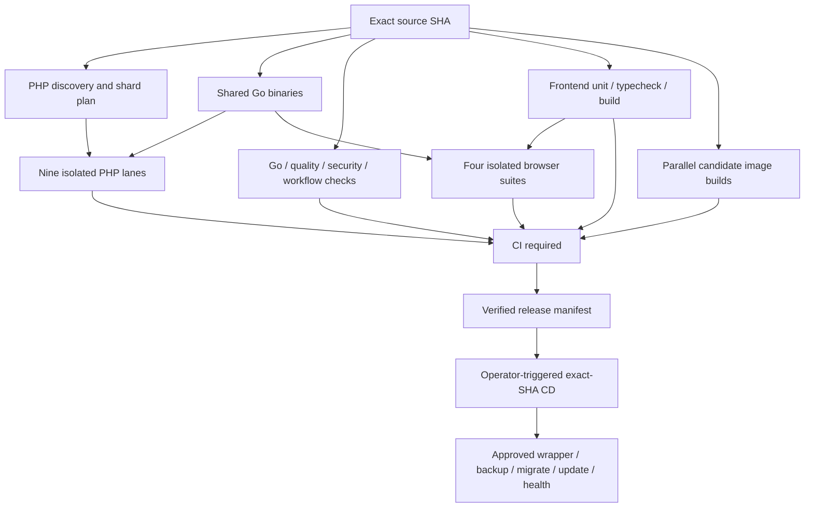

# CI/CD parallelization report

Source implementation is committed locally; local regression verification passes. Hosted CI, GHCR publication, app/web Docker build completion and production/CD timing are not accepted. No push, workflow trigger or VPS mutation was performed.

Baseline: `ad071513cd60307eebe2a0c3d929197693e09449`, main, 32 commits ahead of origin, with two untracked audit files preserved. The previous investigation supplied isolation warnings, not current timing evidence; this session captured a fresh inventory and timings. `rtk` was found under `/home/thunder/.headroom/bin` after it was absent from PATH. Tests used PHP 8.5.12 rather than the incompatible host PHP 8.4.24, PostgreSQL 17.11, Redis 7.4 and Go 1.27.3.

The old CI already had eight PHP lanes, but each built the four Go binaries, Go checks were serial, frontend checks were combined, image builds waited for verification, and no aggregate gate existed. Existing browser scripts and dependency vulnerability audits were outside CI. The new workflow has nine deterministic PHP lanes, independent Go test/race/static jobs, frontend unit/typecheck/build jobs, four isolated browser jobs, PHP quality checks, dependency security and engineering checks. Go binaries are built once and shared as same-run artifacts. Module downloads are cached, normal/race compilation caches are separate, Composer/npm caches contain downloads, and every job installs its own locked dependencies. Matrix cancellation is disabled.

PHP discovery drives file-level weighted partitioning. Measured timings determine placement; unseen files receive a deterministic fallback and cannot disappear. Each shard runs serially in its own runner, PostgreSQL instance, Redis instance and namespace. Strict `bybit_test` safeguards remain intact; there is no ParaTest or SQLite replacement. The aggregate compares all discovered/executed case IDs as multisets and verifies distinct PostgreSQL system identifiers and Redis run IDs/prefixes across all nine lanes. Only the original opt-in public Bybit API smoke test may skip.

Image candidates build concurrently with verification using BuildKit/GHA caches and SHA tags. Each records a digest. `CI required` depends on every mandatory group, rejects non-success/missing jobs, checks full PHP execution and all image records, then publishes deployment eligibility. PR candidates are build-only and cannot authorize production. Main candidates are published before eligibility, so failed verification cannot authorize them. CD independently authorizes exact current main, validates that run's aggregate and digest manifest, transfers a minimal checksummed deployment archive and executes the existing approved wrapper. CD does not test, install dependencies, compile or build. Backup, migrations, rollback, locks and health checks remain.

Three verification iterations were completed:

1. Original inventory/baseline and focused gate negative controls. The working checkout's existing candle journal caused initial failures; a clean temporary checkout was used without deleting that journal. Clean original serial execution found 1 error, 3 failures, 5 skips and 6 PHPUnit notices.
2. Real isolated two/four-worker execution exposed fixture and environment dependencies. Existing assertions were retained: origin tests now explicitly set their request root; the risk-funnel test provisions its own baseline account; the queue warning assertion applies its exact argument filter before its once count. A missing PDO failure mapping around source-policy lookup now emits the already-required fail-closed `CANDLE_STORAGE_UNAVAILABLE` reason. Thirty-eight targeted tests passed. Three Symfony packages were patched from 8.1.8 to 8.1.11 for six reported advisories; strict audits then passed.
3. Complete balanced PHP runs, preserved Go/frontend case inventories, four real browser suites, quality/security, 59 Python engineering tests, workflow validation and deployment regression checks. Historical browser actions now wait for UI readiness, use local fixture adapters and retain the original bounded worker run so delayed jobs execute. Deployment scenarios now genuinely assert Redis key-count preservation instead of merely printing it. Final source changes to deployment helpers received targeted deployment PHP and actual-helper tests. The final inventory reconciliation also added four standalone PHP harnesses (139 pure assertions plus five real PostgreSQL races/two variants), runtime-extension verification and source-redaction regression to required CI. The initial inventory missed these standalone harnesses. Their missing default-config bootstrap and isolated legacy-fixture opt-in were repaired; no assertions or production guards were removed.

| Component | Baseline | New | Status |
|---|---:|---:|---|
| PHP tests | 1,294 cases; 618.44s, failing | 1,294 cases; 12,261 assertions; 240.32s | PASS local |
| PostgreSQL integration | 70.30s serial sum, one error | 47.41s longest PG lane; no mandatory DB skips | PASS local |
| Redis integration | 2.89s | See measured Redis lane in performance report; two cases pass | PASS local |
| Go tests | 113 passing IDs; 3.65s warm | Same 113 IDs; 13.50s cold | PASS |
| Go race | 113 passing IDs; 18.95s | Same 113 IDs; 22.01s | PASS |
| Frontend tests | 76 cases; 0.88s | Same 76 IDs; 1.33s | PASS |
| TypeScript/build | 13.44s combined | 7.89s / 9.44s | PASS |
| Playwright | Existing scripts outside CI | Four suites pass; nine Phase 0 obligations pass | PASS local |
| Security | Six Composer advisories | Zero Composer/npm advisories; module verification passes | PASS |
| Complete test inventory | 1,294 PHP / 113 Go / 76 frontend | Same IDs; zero omissions/duplicates | PASS |
| CI aggregate gate | Absent | Local negative controls and workflow contract pass; hosted run unavailable | FAIL: hosted unverified |
| CD execution | Unmeasured | Not executed | FAIL: unverified |

The PHP total includes one unchanged optional public-network skip; 1,293 cases pass. The six existing PHPUnit notices remain visible. No mandatory test was removed, excluded, weakened, moved to a later release or replaced by a faster database. Go's packages without test files are not mistaken for skipped test cases. Full PHP case identities, original file hashes, JUnit, Go JSON, frontend TAP, isolation identities, benchmark/resource data, security and deployment logs are retained under [cicd_evidence](cicd_evidence/).

The final local four-worker PHP run took 240.32 seconds versus 375.43 with two workers; this is not a hosted total-CI speedup claim. The deployment payload measured about 31 KB versus 9.15 MB for the full same-SHA source archive, with all required deployment members verified. The Go image built locally in 15.15 seconds; app/web builds stalled in dependency installation and were stopped after approximately 392 seconds. No publication duration or production latency was fabricated. The original API returned 404 without authentication, so hosted run history, runner concurrency allowance and branch rules could not be verified.

Remaining acceptance work requires an explicitly authorized remote publication/CI run, confirmation that branch protection requires `CI required`, successful app/web builds and GHCR artifacts, and separate explicit approval for any deployment. Thirty-second CD remains a conditional target, with backup, pull, migration, startup and graceful worker shutdown retained. Current forward-PAPER data and performance were not accessed; all fixture trades and accounts are synthetic.

The frozen platform tracker is reported separately from CI delivery: implementation/verification/product scores are 0/0/0 before and after this stage; tracker tests and strict prior-HEAD validation pass. No platform product acceptance is inferred from local CI tests or commits. Current reports and an immutable progress snapshot record the local evidence and remaining operational obligations.

See [test inventory](CICD_TEST_INVENTORY.md), [performance comparison](CICD_PERFORMANCE_COMPARISON.md), [deployment safety](CICD_DEPLOYMENT_SAFETY.md) and [operator deployment documentation](../../docker/GIT_DEPLOY.md).

Console logs containing native trailing spaces are retained byte-for-byte as gzip files; inspect them with `gzip -dc`. `SHA256SUMS` covers every retained evidence artifact.
